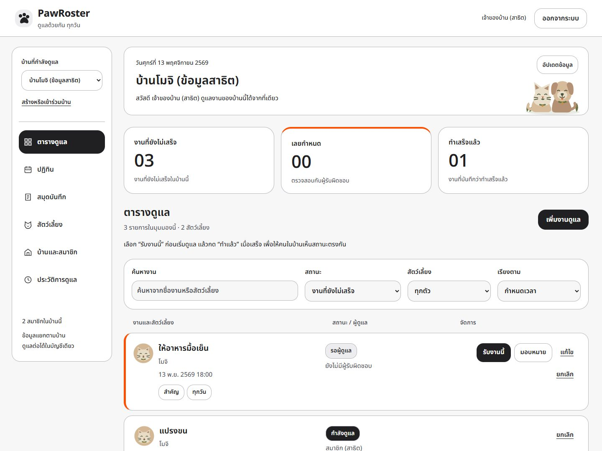
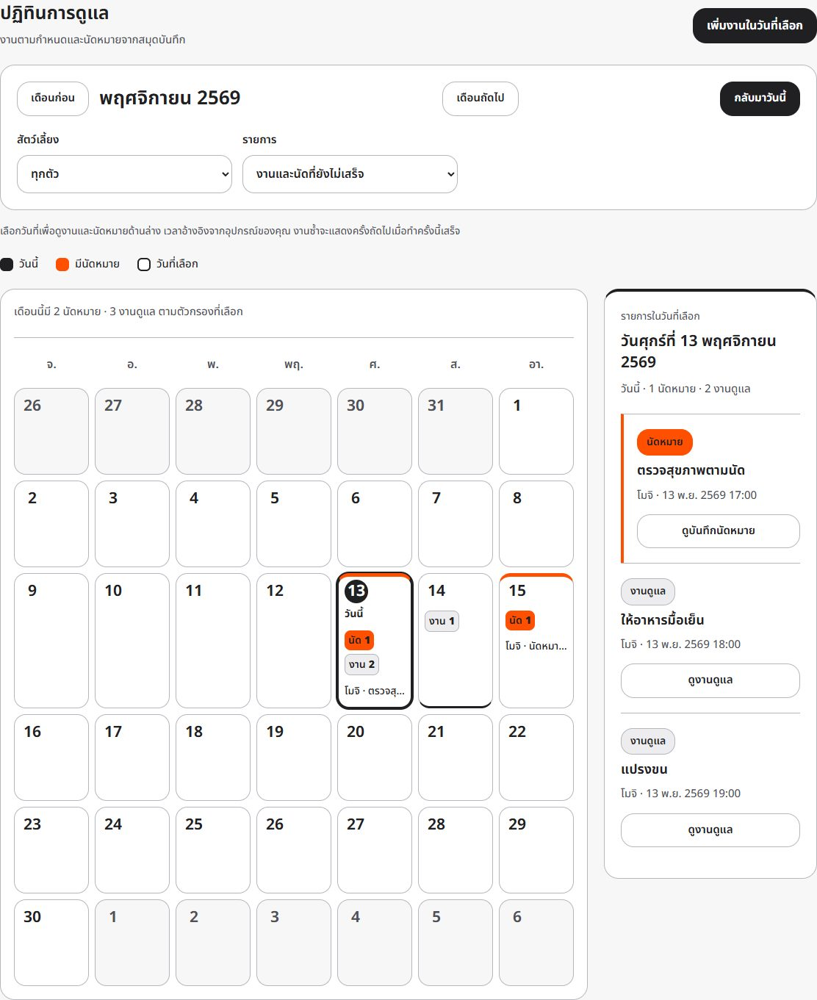

# PawRoster — ดูแลด้วยกัน ทุกวัน

ระบบแบ่งงานดูแลสัตว์เลี้ยงสำหรับสมาชิกในครัวเรือน ช่วยให้เห็นผู้รับผิดชอบ กำหนดเวลา และประวัติการดูแลในพื้นที่เดียวกัน เพื่อลดความสับสนในการประสานงานดูแลสัตว์เลี้ยงร่วมกัน

<a id="installation"></a>

## การติดตั้งและเปิดโปรเจค

**สำหรับการตรวจงานรายวิชา ใช้วิธี Docker-in-Docker ในกล่องอาจารย์ด้านล่างเป็นหลัก** คู่มือนี้รวมการเริ่มระบบ สมัครบัญชี ทดลองใช้งาน และแก้ปัญหาไว้ในหน้าเดียว การเปิดแอปไม่จำเป็นต้องเปิด Jenkins

- [เปิดในกล่องอาจารย์ผ่าน SSH](#course-setup)
- [ทางเลือก: Docker Compose บนเครื่องหลัก](#local-docker)
- [ทดลองใช้งานระบบ](#try-the-app)

<a id="course-setup"></a>

## 🔴 วิธีหลัก: เปิดใน image อาจารย์ผ่าน SSH

> **สำหรับตรวจงานรายวิชา:** รันโปรเจคภายใน image `tuchsanai/devtools:2569_1` ตามขั้นตอนนี้

เตรียม Docker Desktop ที่เปิด Linux containers หรือ Docker Engine, SSH client และอินเทอร์เน็ตสำหรับดาวน์โหลด image และ Source code โดยไม่ต้องติดตั้ง Node.js หรือฐานข้อมูลบนเครื่องหลัก

**ขั้นที่ 1 — รันบนเครื่องหลัก:**

```sh
docker run -dit --name devtools --privileged -p 2222:22 tuchsanai/devtools:2569_1
```

ถ้ามีคอนเทนเนอร์ `devtools` เดิมแล้ว ใช้ `docker start devtools` แทน โดยเก็บข้อมูลเดิมไว้

**ขั้นที่ 2 — เข้า SSH พร้อมเปิดทางเข้าหน้าเว็บ:**

```sh
ssh -L 127.0.0.1:3083:127.0.0.1:3080 root@localhost -p 2222
```

กรอกรหัสผ่านกล่องตามที่อาจารย์กำหนด และเปิด Terminal นี้ค้างไว้ระหว่างใช้งานเว็บ

**ขั้นที่ 3 — รันภายใน SSH ของกล่องอาจารย์:**

```sh
mkdir -p /workspace
cd /workspace
git clone https://github.com/67070282/PawRoster.git
cd PawRoster
export COMPOSE_PROJECT_NAME=pawroster-course
export VCS_REF="$(git rev-parse HEAD)"
sh scripts/assert-course-environment.sh
docker compose up -d --build --wait
docker compose ps
```

ถ้ามี Source code ในกล่องแล้ว ให้เข้าโฟลเดอร์เดิมและตรวจสถานะ Git ก่อนอัปเดต ไม่ Clone ทับไฟล์เดิม

เมื่อ `app` เป็น `healthy` เปิดจากเว็บเบราว์เซอร์บนเครื่องหลัก:

- **หน้าใช้งาน:** [http://localhost:3083](http://localhost:3083)
- **ตรวจสอบบริการ:** [http://localhost:3083/health](http://localhost:3083/health) ควรแสดง `"status":"ok"` พร้อม Version และ Revision ของโค้ด

เส้นทางการรันคือ **เครื่องหลัก → devtools (image อาจารย์) → Docker daemon ภายใน → app container** พอร์ต 3083 ส่งผ่าน SSH tunnel ไปยังแอปในกล่อง

**ตรวจระบบทั้งชุดภายใน SSH:**

```sh
sh scripts/course-verify.sh
```

สคริปต์ตรวจ Tests, Build, Health, หลายบ้าน, งานซ้ำ, Backup และ Persistence แล้วหยุดแอปเมื่อเสร็จ โดยคง Volume หากต้องการเปิดเว็บต่อ ใช้ `docker compose up -d --wait` ใน Terminal และ Compose project เดิม

ดู [คู่มือ Docker-in-Docker ฉบับละเอียด](docs/RUN-IN-COURSE.md) และ [หลักฐานการตรวจสองชั้น](evidence/dind-validation/README.md)

---

## 🔵 ทางเลือกสำหรับพัฒนาและทดลองบนเครื่องหลัก

> **สำหรับพัฒนาและทดลองในเครื่อง:** ใช้ Docker Compose บนเครื่องหลัก ส่วนการตรวจงานรายวิชาใช้หัวข้อวิธีหลักสีแดงด้านบน

หัวข้อถัดไปอธิบายการดาวน์โหลดและเปิดระบบบนเครื่องหลัก ส่วนการตรวจงานในสภาพแวดล้อมรายวิชาใช้วิธีด้านบน

### 1. เตรียมไฟล์โครงงาน

เลือกวิธีใดวิธีหนึ่ง:

**ดาวน์โหลด ZIP**

1. เปิดหน้า Repository แล้วเลือก **Code → Download ZIP** หรือ [ดาวน์โหลดโครงงานจาก branch main](https://github.com/67070282/PawRoster/archive/refs/heads/main.zip)
2. แตกไฟล์ ZIP ให้เรียบร้อยก่อนใช้งาน โฟลเดอร์ที่ได้มักชื่อ `PawRoster-main`
3. เปิด Terminal หรือ PowerShell ในโฟลเดอร์ที่มีไฟล์ `package.json`, `compose.yaml` และ `Dockerfile`

**ดาวน์โหลดด้วย Git**

```sh
git clone https://github.com/67070282/PawRoster.git
cd PawRoster
```

ระบบเป็นเว็บแอปพลิเคชันที่มี Backend และฐานข้อมูล จึงเปิดใช้งานผ่าน Docker Compose ตามหัวข้อ 2 การดับเบิลคลิก `public/index.html` เพียงอย่างเดียวจะยังใช้งานระบบไม่ได้

<a id="local-docker"></a>

### 2. เปิดระบบด้วย Docker Compose บนเครื่องหลัก

#### สิ่งที่ใช้

- Docker Desktop ที่เปิดทำงานอยู่และใช้ Linux containers หรือ Docker Engine บน Linux
- Docker Compose v2
- เว็บเบราว์เซอร์ เช่น Chrome, Edge หรือ Firefox
- อินเทอร์เน็ตสำหรับดาวน์โหลด Base image ในการ Build ครั้งแรก

วิธีนี้ไม่ต้องติดตั้ง Node.js หรือฐานข้อมูลแยกบนเครื่อง

#### ตรวจสอบ Docker

รันคำสั่งจากโฟลเดอร์โครงงาน:

```sh
docker version
docker compose version
```

คำสั่งแรกควรแสดงข้อมูลทั้ง Client และ Server จากนั้นเริ่มระบบ:

```sh
docker compose up -d --build --wait
docker compose ps
```

การ Build ครั้งแรกอาจใช้เวลาสักครู่ เมื่อบริการ `app` แสดงสถานะ `healthy` ให้เปิด:

**หน้าใช้งาน:** [http://localhost:3080](http://localhost:3080)

**ตรวจสอบบริการ:** [http://localhost:3080/health](http://localhost:3080/health)

Health endpoint ควรตอบกลับเป็น JSON ที่มี `"status":"ok"` ฐานข้อมูลและตารางจะถูกสร้างโดยระบบเมื่อเริ่มใช้งาน

<a id="try-the-app"></a>

### 3. ทดลองใช้งานระบบ

ระบบเริ่มต้นด้วยฐานข้อมูลว่าง ไม่มีบัญชีสาธิตสำเร็จรูป สามารถสร้างข้อมูลสำหรับตรวจงานได้ดังนี้

#### สร้างบัญชีและบ้าน

1. เลือกแท็บ **สร้างบัญชี**
2. กรอกชื่อที่แสดง เช่น “ผู้ตรวจ A”
3. กรอกชื่อบ้านใหม่ เช่น “บ้านสาธิต PawRoster” และเว้นช่องรหัสเข้าร่วมบ้านเดิม
4. กรอกอีเมลสำหรับทดสอบ เช่น `reviewer.a@example.com` พร้อมตั้งรหัสผ่านอย่างน้อย 10 ตัวอักษร แล้วกดสร้างบัญชี

ตัวอย่างอีเมลใช้เป็นชื่อบัญชีสำหรับทดสอบ ระบบไม่มีการส่งอีเมลยืนยัน

#### เพิ่มสัตว์เลี้ยงและงานดูแล

1. เลือกเมนู **สัตว์เลี้ยง** แล้วกด **เพิ่มสัตว์เลี้ยง** กรอกชื่อ ประเภท และข้อควรทราบ (ถ้ามี) แล้วกด **บันทึกสัตว์เลี้ยง**
2. เลือกเมนู **ตารางดูแล** กด **เพิ่มงานดูแล** เลือกสัตว์เลี้ยง กรอกงาน เช่น “ให้อาหารมื้อเย็น” กำหนดวันเวลา ความสำคัญ และการทำซ้ำ แล้วกด **บันทึกงานดูแล**
3. รายการจะปรากฏใน **ตารางดูแล** พร้อมสถานะ “รอผู้ดูแล”

#### รับงานและบันทึกผล

1. กด **รับงานนี้** สถานะจะเปลี่ยนเป็น “กำลังดูแล”
2. ผู้รับงานกด **ทำแล้ว** เพิ่มหมายเหตุได้ แล้วกด **ยืนยันว่าทำแล้ว**
3. เลือกตัวกรอง **งานทั้งหมด** หรือ **ทำแล้ว** เพื่อตรวจรายการที่เสร็จแล้ว
4. ตรวจสอบผู้ทำรายการและประวัติในเมนู **ประวัติการดูแล**

ผู้รับงานสามารถเลือก **คืนงาน** เพื่อให้งานกลับมารอผู้รับผิดชอบได้

#### ทดลองการทำงานร่วมกันสองบัญชี

1. จากบัญชีเจ้าของบ้าน เปิดเมนู **บ้านและสมาชิก** แล้วคัดลอกรหัสในส่วน **เชิญสมาชิก**
2. เปิดหน้าต่างส่วนตัว เช่น Incognito หรือ InPrivate แล้วเข้า URL เดิม เพื่อแยก Session จากบัญชีแรก
3. สร้างบัญชีที่สองด้วยอีเมลต่างกัน เช่น `reviewer.b@example.com` กรอกรหัสเข้าร่วมบ้าน และเว้นชื่อบ้านใหม่
4. ทั้งสองบัญชีจะเห็นข้อมูลบ้านเดียวกัน กด **อัปเดตข้อมูล** เพื่อโหลดสถานะล่าสุด
5. ทดลองรับงานที่ยังว่างจากบัญชีหนึ่ง อีกบัญชีจะไม่สามารถรับงานนั้นซ้ำ หรือยืนยันงานแทนผู้รับงานได้

#### เข้าร่วมบ้านอื่นหลังสมัครแล้ว

1. เข้าสู่ระบบด้วยบัญชีเดิม แล้วเลือก **สร้างหรือเข้าร่วมบ้าน**
2. วางรหัสจากเจ้าของบ้านในส่วน **เข้าร่วมด้วยรหัสเชิญ** แล้วกด **เข้าร่วมบ้าน**
3. ใช้รายการ **สลับบ้าน** เพื่อเปลี่ยนบ้านที่กำลังดูแล ข้อมูลและงานของแต่ละบ้านแยกจากกัน
4. สร้างบ้านเพิ่มเติมได้จากหน้าต่างเดียวกัน โดยไม่ต้องสมัครบัญชีใหม่

#### ทดลองงานซ้ำและการจัดการบ้าน

- สร้างงานโดยเลือก **ทุกวัน** หรือ **ทุกสัปดาห์** เมื่อยืนยันว่าเสร็จ ระบบจะสร้างรายการใหม่ที่ยังไม่มีผู้รับผิดชอบเพียงหนึ่งรายการ โดยนับเวลาจากกำหนดเดิม
- ใช้ตัวกรอง **งานที่ฉันรับ**, **ครบกำหนดวันนี้**, **เลยกำหนด** และช่องค้นหาเพื่อตรวจรายการ
- เจ้าของบ้านจัดการรหัสเชิญ สมาชิก และการโอนสิทธิ์ได้จาก **บ้านและสมาชิก**
- สมาชิกเลือก **ออกจากบ้านนี้** ได้ งานที่ยังรับค้างไว้จะกลับไปรอผู้รับผิดชอบ โดยประวัติเดิมยังอยู่

#### การจัดการสมาชิกและรหัสเชิญ

ไปที่ **บ้านและสมาชิก** เจ้าของบ้านนำสมาชิกออกและบล็อกบัญชีได้ ระบบเปลี่ยนรหัสเชิญให้อัตโนมัติ รหัสเก่าใช้ไม่ได้ทั้งสมัครใหม่และเข้าร่วมด้วยบัญชีเดิม เจ้าของบ้านปลดบล็อก พัก/เปิดรับสมาชิก และดูประวัติการจัดการได้ สมาชิกทั่วไปจัดการสิทธิ์คนอื่นไม่ได้ ดู [รายละเอียดความปลอดภัยและข้อจำกัด](docs/SECURITY.md)

#### สมุดบันทึกและปฏิทิน

1. เลือก **สมุดบันทึก** แล้วกด **เพิ่มบันทึก** เลือกสัตว์เลี้ยง ประเภท หัวข้อ วันที่ และรายละเอียด
2. ประเภทน้ำหนักใช้หน่วยกิโลกรัม เลือกสัตว์เลี้ยงหนึ่งตัวเพื่อดูน้ำหนักล่าสุดและความต่างจากครั้งก่อน
3. วัคซีน/พบสัตวแพทย์ใส่นัดหมายครั้งถัดไปได้ นัดจะปรากฏใน **ปฏิทิน** และทำเครื่องหมายเสร็จได้
4. เลือกวันที่ในปฏิทินเพื่อดูรายการ หรือกด **เพิ่มงานในวันที่เลือก**
5. เจ้าของบ้านใช้ **มอบหมาย** ในรายการงานเพื่อเลือกสมาชิกผู้รับผิดชอบได้

#### ลบสัตว์เลี้ยงและกู้คืน

เจ้าของบ้านเลือก **สัตว์เลี้ยง → ลบสัตว์เลี้ยง** แล้วพิมพ์ชื่อยืนยัน งานค้างจะถูกยกเลิก สัตว์เลี้ยงย้ายไป **ถังขยะ** โดยประวัติและสมุดบันทึกยังอยู่ เลือกมุมมองถังขยะแล้วกด **กู้คืนสัตว์เลี้ยง** ได้ ถังขยะไม่มีวันหมดอายุ หากต้องการนำข้อมูลออกจากระบบ เลือก **ถังขยะ → ลบถาวร** แล้วพิมพ์ชื่อยืนยัน ข้อมูลสัตว์เลี้ยง งาน ประวัติ สมุดบันทึก และนัดหมายของตัวนั้นจะถูกลบและกู้คืนผ่านหน้าเว็บไม่ได้ ส่วน **เก็บประวัติ** ใช้หยุดสร้างงานใหม่โดยยังเก็บการ์ดไว้ สมาชิกทั่วไปจะมีข้อความอธิบายสิทธิ์และไม่มีปุ่มลบ

### 4. หยุดและเปิดระบบใหม่

สำหรับ Docker ให้รันจากโฟลเดอร์เดิมและ Compose project เดิม หากรันในกล่องอาจารย์ให้เข้า SSH และตั้ง `COMPOSE_PROJECT_NAME=pawroster-course` ก่อนใช้คำสั่ง:

```sh
docker compose down
```

เมื่อเปิดครั้งถัดไป:

```sh
docker compose up -d --wait
```

ข้อมูลจะยังอยู่ใน Docker named volume และสามารถเข้าสู่ระบบด้วยบัญชีเดิมได้ การใช้ `docker compose down -v` จะลบ Volume พร้อมข้อมูล จึงไม่ใช้คำสั่งนี้หากต้องการเก็บข้อมูลตรวจงาน

### 5. คำสั่งตรวจสอบและแก้ปัญหาเบื้องต้น

| อาการ | วิธีตรวจสอบ |
|---|---|
| Docker ติดต่อ Server ไม่ได้ | เปิด Docker Desktop รอให้ Engine พร้อม แล้วรัน `docker version` อีกครั้ง |
| ไม่พบไฟล์ Compose หรือ package.json | เปิด Terminal ในโฟลเดอร์โครงงานหลังแตก ZIP ให้เรียบร้อย |
| พอร์ต 3080 ถูกใช้งาน | คัดลอก `.env.example` เป็น `.env` แก้ `APP_PORT=3081` แล้วรันคำสั่งเริ่ม Docker ใหม่ จากนั้นเข้า `http://localhost:3081` |
| หน้าเว็บเข้าไม่ได้ | ตรวจ URL ตามวิธีที่เลือก: กล่องอาจารย์ผ่าน SSH tunnel ใช้ 3083 และ Docker บนเครื่องหลักใช้ 3080 |
| บริการ Docker ไม่ Healthy | ตรวจรายละเอียดด้วย `docker compose ps` และ `docker compose logs --tail=100 app` |
| Node.js แสดง SQLite ExperimentalWarning | เป็นข้อความจาก Node.js หากแสดงข้อความเริ่มบริการและ Health ตอบกลับปกติ สามารถทดลองระบบต่อได้ |
| รับงานไม่ได้หรือไม่พบปุ่มทำแล้ว | ตรวจว่ามีผู้รับงานแล้วหรือไม่ เฉพาะผู้รับงานเท่านั้นที่คืนงานหรือยืนยันการดูแลได้ |
| งานหายจากรายการหลังทำเสร็จ | เปลี่ยนตัวกรองจาก “งานที่ยังไม่เสร็จ” เป็น “งานทั้งหมด” หรือ “ทำแล้ว” |

ตรวจไวยากรณ์ของโค้ดในบริการ Docker ที่เปิดอยู่:

```sh
docker compose exec -T app npm run check
```

รันชุดทดสอบครบจากโฟลเดอร์โครงงานภายใน SSH ของกล่องอาจารย์:

```sh
sh scripts/course-verify.sh
```

Production image ไม่รวมโฟลเดอร์ชุดทดสอบ สคริปต์ Course verification ใช้ Source code ในกล่องเพื่อรัน Tests แยก แล้วตรวจแอปที่ Build และ Deploy จริง

---

## ภาพรวมโครงงาน

**รุ่น 2.2 — สมุดบันทึก ปฏิทิน และการจัดการสมาชิก:** เพิ่มประวัติน้ำหนัก วัคซีน นัดหมาย ปฏิทินงาน การมอบหมายสมาชิก และถังขยะสัตว์เลี้ยงที่กู้คืนได้ โดยยังรองรับหลายบ้านและงานซ้ำ ดู [ฟีเจอร์และวิธีใช้งาน](docs/CARE-FEATURES.md)

โครงงานนี้จัดทำภายใต้หัวข้อ **PetTech × DevTools** โดยใช้ JavaScript, Node.js 24 และ SQLite พร้อมกระบวนการพัฒนาและทดสอบผ่าน Git, Docker Compose และ Jenkins

### หน้าจอรุ่นปัจจุบัน 2.2

ภาพจากแอปที่รันจริงใน image อาจารย์ วันที่ 13 พฤศจิกายน 2569 ใช้บัญชีและข้อมูลสาธิต แสดงธีมพื้นสว่าง ข้อความเข้ม และสีส้มเน้นนัดหมาย

**ตารางดูแล — สถานะงาน ผู้รับผิดชอบ และงานที่ต้องทำ**



**ปฏิทิน — วันนี้ วันที่มีนัด และรายละเอียดวันที่เลือก**



**สมุดบันทึก — น้ำหนักล่าสุดและประวัติของสัตว์เลี้ยง**


ดูครบทุกหน้ารวม **สัตว์เลี้ยง บ้านและสมาชิก ประวัติ และมือถือ** ใน [ภาพหน้าจอและคำอธิบาย](docs/SCREENSHOTS.md) ผลทดสอบรุ่นปัจจุบันอยู่ใน [รายงานการประเมินระบบ](docs/RESEARCH.md) ภาพและ evidence รุ่นก่อนเก็บไว้เป็นประวัติตามเวอร์ชัน

## ที่มาและวัตถุประสงค์

การดูแลสัตว์เลี้ยงในบ้านที่มีผู้ดูแลหลายคนอาจเกิดความไม่ชัดเจนว่าใครรับผิดชอบงานใด และงานนั้นดำเนินการแล้วหรือยัง PawRoster จึงออกแบบให้สมาชิกมองเห็นสถานะงานร่วมกัน ตั้งแต่การสร้างงาน รับงาน บันทึกการดูแล ไปจนถึงตรวจสอบประวัติย้อนหลัง

วัตถุประสงค์ของโครงงาน ได้แก่

- จัดการงานดูแลสัตว์เลี้ยงและกำหนดผู้รับผิดชอบในครัวเรือน
- แสดงสถานะและกำหนดเวลาของงานอย่างเป็นระบบ
- จัดเก็บประวัติการดำเนินงานเพื่อให้ตรวจสอบย้อนหลังได้
- ประยุกต์ใช้เครื่องมือ DevTools ตั้งแต่การจัดการเวอร์ชันจนถึงการทดสอบและนำระบบขึ้นใช้งานในสภาพแวดล้อมทดสอบ

## คุณสมบัติของระบบ

- สมัครบัญชี เข้าสู่ระบบ ออกจากระบบ และเข้าร่วมบ้านด้วยรหัสเชิญ
- แยกข้อมูลและตรวจสอบสิทธิ์การเข้าถึงระหว่างครัวเรือนที่ฝั่ง Backend
- สร้าง เข้าร่วม และสลับหลายบ้านภายในบัญชีเดียว โดยแยกสมาชิก สัตว์เลี้ยง และงานตามบ้าน
- เจ้าของบ้านเปลี่ยนชื่อบ้าน เปลี่ยนรหัสเชิญ พักรับสมาชิก นำออกและบล็อก ปลดบล็อก และโอนสิทธิ์เจ้าของได้ สมาชิกออกจากบ้านได้
- เพิ่มและแก้ไขข้อมูลสัตว์เลี้ยง สายพันธุ์ เพศ วันเกิด และข้อควรทราบ
- เจ้าของบ้านย้ายสัตว์เลี้ยงเข้าถังขยะ กู้คืน หรือลบถาวรพร้อมข้อมูลที่เกี่ยวข้องได้ โดยพิมพ์ชื่อยืนยัน
- สมุดบันทึกน้ำหนัก วัคซีน พบสัตวแพทย์ และบันทึกทั่วไป พร้อมแก้ไข ค้นหา กรอง และส่งออก CSV
- ปฏิทินรวมงานและนัดหมาย เน้นวันนี้/วันมีนัด แสดงรายละเอียดรายวัน กรองสัตว์เลี้ยงและสร้างงานในวันที่เลือก
- เจ้าของบ้านมอบหมายงานให้สมาชิก ผู้รับเห็นใน “งานที่ฉันรับ”
- สร้างงานแบบครั้งเดียว รายวัน หรือรายสัปดาห์ พร้อมความสำคัญและกำหนดเวลา
- ค้นหา กรองตามสัตว์เลี้ยง งานของฉัน งานวันนี้ งานเลยกำหนด และเรียงตามความสำคัญ
- ผู้สร้างงานหรือเจ้าของบ้านแก้ไขงานที่ยังไม่มีผู้รับ และยกเลิกงานที่ยังไม่เสร็จได้
- รับงาน คืนงาน และบันทึกงานที่เสร็จแล้วพร้อมหมายเหตุ
- จำกัดผู้รับงานครั้งละหนึ่งคน และอนุญาตให้ผู้รับงานเป็นผู้คืนงานหรือยืนยันการดูแล
- แสดงงานที่เลยกำหนด กรองรายการงาน และดูประวัติ 50 กิจกรรมล่าสุด
- บันทึกการเปลี่ยนสถานะงานและประวัติใน Transaction เดียวกัน พร้อมจัดเก็บข้อมูลถาวรด้วย SQLite

ลำดับการใช้งานหลัก: **สร้างบ้าน → เชิญสมาชิก → เพิ่มสัตว์เลี้ยง → สร้างงาน → รับงาน → บันทึกการดูแล → ตรวจสอบประวัติ**

## เทคโนโลยีที่ใช้

| ส่วนประกอบ | เทคโนโลยี |
|---|---|
| Frontend | HTML, CSS และ JavaScript |
| Backend | Node.js 24 และ HTTP API |
| ฐานข้อมูล | SQLite ผ่าน `node:sqlite` |
| การจัดการเวอร์ชัน | Git และ GitHub |
| สภาพแวดล้อมใช้งาน | Docker และ Docker Compose |
| CI/CD | Jenkins |
| การทดสอบ | Node.js Test Runner, HTTP acceptance tests และ Smoke tests |

ระบบไม่ใช้ npm dependencies สำหรับ Runtime

## สมาชิกผู้จัดทำ

| ชื่อ–นามสกุล | รหัสประจำตัว |
|---|---|
| นายคณุตม์ บัวชู | 67070206 |
| นายรชต มาลัยพงษ์ | 67070272 |
| นายรัชชานนท์ กิตติสัตยาวัจน์ | 67070273 |
| นายศรันย์ สุภาเพียร | 67070282 |

รายละเอียดโครงงานอยู่ใน [รายงานโครงงาน](docs/PROJECT.md)

## การทดสอบและผลการตรวจสอบ

คำสั่งสำหรับตรวจสอบโค้ด ทดสอบระบบ และตรวจสอบบริการ:

```sh
npm run check
npm test
docker compose config --quiet
docker compose ps
docker compose exec -T app node -e "fetch('http://127.0.0.1:3000/health').then(async r=>{if(!r.ok)process.exit(1);console.log(await r.text())})"
```

| รายการ | ผลรุ่น 2.2 |
|---|---|
| Acceptance tests | ผ่าน 32 กรณี (33 TAP records รวม Parent), fail 0 ทั้ง Windows และ Linux ใน image อาจารย์ |
| Web/UI | Flow งาน สมุดบันทึก ปฏิทิน ถังขยะและการจัดการสมาชิกผ่าน |
| Course Docker-in-Docker | Syntax, build, revision health และ deployed HTTP smoke ผ่าน |
| ข้อมูล | Online backup/integrity และ force-recreate persistence ผ่าน |
| Jenkins CI/CD รุ่น 2.2 | main #1 และ review #1 ผ่าน; review #2 ยืนยัน failure gate ใน workspace ทดสอบ |
| ความปลอดภัยของบ้าน | รหัสเก่าใช้ไม่ได้ บล็อก/ปลดบล็อก พักรับสมาชิก และการตัดสิทธิ์ผ่าน |

รายละเอียดวิธีทดสอบ ผลจริง และขอบเขตหลักฐานอยู่ใน [รายงานการประเมินระบบ](docs/RESEARCH.md) และ [รายการตรวจส่ง](docs/SUBMISSION-AUDIT.md) หลักฐาน source รุ่น 2.2 อยู่ใน [evidence/household-security](evidence/household-security/README.md) ส่วน evidence รุ่นก่อนใช้อ้างอิงเฉพาะวันที่และ commit ที่ระบุ

## ขอบเขตการประเมิน

รุ่นปัจจุบันรองรับหลายบ้านต่อบัญชีและงานซ้ำแบบสร้างรายการถัดไปหลังทำรายการปัจจุบันเสร็จ โดยนับจากกำหนดเดิมทุก 24 ชั่วโมงหรือ 7 วัน ยังไม่ครอบคลุมการแจ้งเตือนอีเมลหรือ Push notification การลบบัญชี และคำแนะนำด้านการรักษาสัตว์เลี้ยง รหัสเชิญไม่มีวันหมดอายุอัตโนมัติ แต่เจ้าของบ้านเปลี่ยนรหัสได้ ระบบไม่มีการใช้ LLM ในการทำงานของแอปพลิเคชัน

การประเมินโครงงานใช้ข้อมูลสังเคราะห์เพื่อยืนยันความถูกต้องของระบบและการส่งมอบซ้ำ ไม่สรุปผลด้านสุขภาพสัตว์หรือการลดงานตกหล่นเป็นตัวเลข ดู [รายงานผลทดสอบ](docs/RESEARCH.md)

## โครงสร้าง Repository

```text
PawRoster/
├── src/server.js          # HTTP API, authentication, business rules และ SQLite
├── public/                # หน้าเว็บ HTML/CSS/JavaScript
├── test/system.test.js    # HTTP acceptance tests
├── scripts/               # Backup, smoke และ Course Container verification
├── docs/                  # เอกสารโครงงาน สถาปัตยกรรม และการใช้งาน
├── evidence/              # ผลทดสอบและหลักฐานการตรวจสอบ
├── presentation/          # สไลด์นำเสนอ
├── .github/               # Issue และ Pull Request templates
├── compose.yaml
├── Dockerfile
├── Jenkinsfile
└── CONTRIBUTING.md
```

## เอกสารประกอบโครงงาน

- [สมุดบันทึก ปฏิทิน และการลบ/กู้คืนสัตว์เลี้ยง](docs/CARE-FEATURES.md)
- [รายงานโครงงานและ Acceptance Criteria](docs/PROJECT.md)
- [ภาพหน้าจอรุ่นปัจจุบันและคู่มือแต่ละหน้า](docs/SCREENSHOTS.md)
- [สถาปัตยกรรมระบบและ API](docs/ARCHITECTURE.md)
- [การติดตั้ง Jenkins, Course Container และการสำรองข้อมูล](docs/OPERATIONS.md)
- [ตาราง Traceability เชื่อมโยงข้อกำหนดกับหลักฐาน](docs/TRACEABILITY.md)
- [การตรวจสอบความสอดคล้องกับเกณฑ์โครงงาน](docs/SUBMISSION-AUDIT.md)
- [รายงานการประเมินระบบและผลทดสอบ](docs/RESEARCH.md)
- [กระบวนการทำงานบน GitHub](docs/GITHUB.md)
- [แนวทางการร่วมพัฒนา](CONTRIBUTING.md)
- [สไลด์นำเสนอ 10 หน้า](presentation/index.html) — ใช้ประกอบคลิปนำเสนอประมาณ 22 นาที 30 วินาที เปิดด้วยเว็บเบราว์เซอร์ รองรับปุ่มลูกศรและการพิมพ์เป็น PDF

## แหล่งอ้างอิง

- [รายละเอียด Mini Project — DevTools](https://github.com/Tuchsanai/DevTools/tree/main/Mini_Project)
- [ข้อกำหนดและเกณฑ์โครงงาน](https://github.com/Tuchsanai/DevTools/tree/main/Mini_Project/project-details)

## เครื่องมือสนับสนุนการพัฒนา

โครงงานนี้ใช้ OpenAI Codex เป็นเครื่องมือช่วยในการวิเคราะห์ข้อกำหนด ออกแบบระบบ พัฒนาโค้ด จัดทำชุดทดสอบ และเรียบเรียงเอกสารประกอบ
