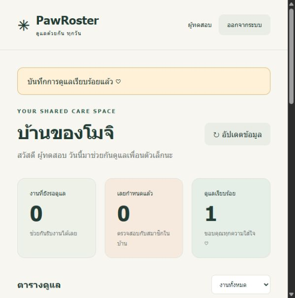

# PawRoster — ดูแลด้วยกัน ทุกวัน

ระบบแบ่งงานดูแลสัตว์เลี้ยงสำหรับสมาชิกในครัวเรือน ช่วยให้เห็นผู้รับผิดชอบ กำหนดเวลา และประวัติการดูแลในพื้นที่เดียวกัน เพื่อลดความสับสนในการประสานงานดูแลสัตว์เลี้ยงร่วมกัน

โครงงานนี้จัดทำภายใต้หัวข้อ **PetTech × DevTools** โดยใช้ JavaScript, Node.js 24 และ SQLite พร้อมกระบวนการพัฒนาและทดสอบผ่าน Git, Docker Compose และ Jenkins



## ที่มาและวัตถุประสงค์

การดูแลสัตว์เลี้ยงในบ้านที่มีผู้ดูแลหลายคนอาจเกิดความไม่ชัดเจนว่าใครรับผิดชอบงานใด และงานนั้นดำเนินการแล้วหรือยัง PawRoster จึงออกแบบให้สมาชิกมองเห็นสถานะงานร่วมกัน ตั้งแต่การสร้างงาน รับงาน บันทึกการดูแล ไปจนถึงตรวจสอบประวัติย้อนหลัง

วัตถุประสงค์ของโครงงาน ได้แก่

- จัดการงานดูแลสัตว์เลี้ยงและกำหนดผู้รับผิดชอบในครัวเรือน
- แสดงสถานะและกำหนดเวลาของงานอย่างเป็นระบบ
- จัดเก็บประวัติการดำเนินงานเพื่อให้ตรวจสอบย้อนหลังได้
- ประยุกต์ใช้เครื่องมือ DevTools ตั้งแต่การจัดการเวอร์ชันจนถึงการทดสอบและนำระบบขึ้นใช้งานในสภาพแวดล้อมทดสอบ

## คุณสมบัติของระบบ

- สมัครบัญชี เข้าสู่ระบบ ออกจากระบบ และเข้าร่วมบ้านด้วยรหัสเชิญ
- แยกข้อมูลและตรวจสอบสิทธิ์การเข้าถึงระหว่างครัวเรือนที่ฝั่ง Backend
- เพิ่มข้อมูลสัตว์เลี้ยงและสร้างงานแบบครั้งเดียวพร้อมกำหนดวันเวลา
- รับงาน คืนงาน และบันทึกงานที่เสร็จแล้วพร้อมหมายเหตุ
- จำกัดผู้รับงานครั้งละหนึ่งคน และอนุญาตให้ผู้รับงานเป็นผู้คืนงานหรือยืนยันการดูแล
- แสดงงานที่เลยกำหนด กรองรายการงาน และดูประวัติ 50 กิจกรรมล่าสุด
- บันทึกการเปลี่ยนสถานะงานและประวัติใน Transaction เดียวกัน พร้อมจัดเก็บข้อมูลถาวรด้วย SQLite

ลำดับการใช้งานหลัก: **สร้างบ้าน → เชิญสมาชิก → เพิ่มสัตว์เลี้ยง → สร้างงาน → รับงาน → บันทึกการดูแล → ตรวจสอบประวัติ**

## เทคโนโลยีที่ใช้

| ส่วนประกอบ | เทคโนโลยี |
|---|---|
| Frontend | HTML, CSS และ JavaScript |
| Backend | Node.js 24 และ HTTP API |
| ฐานข้อมูล | SQLite ผ่าน `node:sqlite` |
| การจัดการเวอร์ชัน | Git และ GitHub |
| สภาพแวดล้อมใช้งาน | Docker และ Docker Compose |
| CI/CD | Jenkins |
| การทดสอบ | Node.js Test Runner, HTTP acceptance tests และ Smoke tests |

ระบบไม่ใช้ npm dependencies สำหรับ Runtime

## สมาชิกผู้จัดทำ

| ชื่อ–นามสกุล | รหัสประจำตัว |
|---|---|
| นายคณุตม์ บัวชู | 67070206 |
| นายรชต มาลัยพงษ์ | 67070272 |
| นายรัชชานนท์ กิตติสัตยาวัจน์ | 67070273 |
| นายศรันย์ สุภาเพียร | 67070282 |

ข้อมูล Section หมายเลขกลุ่ม และรายละเอียดหน้าที่รับผิดชอบอยู่ระหว่างการจัดทำ โดยรวบรวมไว้ใน [เอกสารโครงงาน](docs/PROJECT.md)

## การติดตั้งและใช้งาน

### ใช้งานผ่าน Docker Compose

สภาพแวดล้อมที่ใช้: Docker Engine และ Docker Compose v2

```sh
docker compose up -d --build --wait
```

เปิด [http://localhost:3080](http://localhost:3080) เพื่อสมัครบัญชีและสร้างบ้าน สมาชิกคนอื่นสามารถสมัครเข้าร่วมบ้านด้วยรหัสจากเมนู “เชิญสมาชิกเข้าบ้าน” รหัสเชิญใช้สำหรับเข้าถึงข้อมูลของบ้าน จึงเหมาะสำหรับแบ่งปันเฉพาะสมาชิกในครัวเรือน

หากพอร์ต 3080 ถูกใช้งานอยู่ สามารถคัดลอก `.env.example` เป็น `.env` แล้วกำหนดค่า `APP_PORT` ใหม่ได้

### ใช้งานด้วย Node.js

สภาพแวดล้อมที่ใช้: Node.js 24.14.x ซึ่งรองรับ `node:sqlite` โดยไม่ต้องติดตั้งแพ็กเกจเพิ่มเติม

```sh
npm start
```

เปิด [http://localhost:3000](http://localhost:3000) ข้อมูลถูกจัดเก็บใน `data/pawroster.db` ทั้งนี้ Node.js อาจแสดง `ExperimentalWarning` เกี่ยวกับ SQLite ซึ่งแยกจากผลการทดสอบระบบ

## การทดสอบและผลการตรวจสอบ

คำสั่งสำหรับตรวจสอบโค้ด ทดสอบระบบ และตรวจสอบบริการ:

```sh
npm run check
npm test
docker compose config --quiet
docker compose ps
docker compose exec -T app node -e "fetch('http://127.0.0.1:3000/health').then(async r=>{if(!r.ok)process.exit(1);console.log(await r.text())})"
```

| รายการ | ผลการตรวจสอบที่บันทึกไว้ |
|---|---|
| Web, API และฐานข้อมูล | ผ่านการตรวจสอบ HTTP และส่วนติดต่อผู้ใช้ |
| HTTP acceptance tests | ผ่าน 8 กรณีทดสอบ โดย Node.js รายงานรวม 9 รายการเมื่อรวมชุดทดสอบหลัก |
| Docker Compose | ผ่านการ Build และตรวจสอบ Health |
| การจัดเก็บข้อมูล | ผ่านการสำรองและกู้คืน รวมถึงตรวจสอบข้อมูลหลังสร้างคอนเทนเนอร์ใหม่ |
| Course Container | ผ่านการทดสอบใน `tuchsanai/devtools:2569_1` |
| Jenkins | ผ่าน Build, Publish, Deploy, Health และ Smoke tests ในสภาพแวดล้อมทดสอบ |
| การศึกษากับผู้ใช้ | อยู่ระหว่างเตรียมเก็บข้อมูลสัมภาษณ์และทดลองใช้งานจริง |

หลักฐานประกอบ: [ผลการตรวจสอบระบบ](evidence/VERIFICATION.md), [ผลทดสอบ Linux](evidence/linux-tests.tap), [Course Container](evidence/course/README.md), [การตรวจสอบหลังรวมโค้ด](evidence/course-main/README.md) และ [Jenkins](evidence/jenkins/README.md)

[Pull Request #1](https://github.com/67070282/PawRoster/pull/1) รวมเข้าสู่ `main` แล้ว โดยมีการตรวจสอบ Jenkins ทั้ง Review branch และกรณีทดสอบล้มเหลวเพื่อยืนยันการหยุด Pipeline ก่อนขั้นตอนถัดไป ผลยืนยันเพิ่มเติมจาก Main build #5 ผ่านกระบวนการครบที่ Commit [`80914ea`](https://github.com/67070282/PawRoster/commit/80914ea38d6527fc8a95bf7160a39b73413746a3) โดย Health endpoint แสดง Revision ตรงกับโค้ดที่นำขึ้นใช้งาน ผลดังกล่าวเป็นผลของรุ่นที่ระบุ

## ขอบเขตและแผนการประเมิน

รุ่นปัจจุบันรองรับการแบ่งงานภายในบ้านหนึ่งหลังต่อบัญชี โดยยังไม่ครอบคลุมงานที่เกิดซ้ำอัตโนมัติ การแจ้งเตือนทางอีเมลหรือ Push notification การลบบัญชี และคำแนะนำด้านการรักษาสัตว์เลี้ยง ระบบไม่มีการใช้ LLM ในการทำงานของแอปพลิเคชัน

การประเมินประโยชน์ต่อผู้ใช้จะอาศัยข้อมูลสัมภาษณ์และการทดลองใช้งานจริงตาม [แผนการศึกษา](docs/RESEARCH.md) ปัจจุบันยังไม่มีผลการศึกษาสำหรับสรุปการลดงานที่ตกหล่นหรือผลด้านสุขภาพของสัตว์เลี้ยง โดยติดตามงานส่วนนี้ใน [Issue #2](https://github.com/67070282/PawRoster/issues/2) และรายละเอียดทีมใน [Issue #3](https://github.com/67070282/PawRoster/issues/3)

## โครงสร้าง Repository

```text
PawRoster/
├── src/server.js          # HTTP API, authentication, business rules และ SQLite
├── public/                # หน้าเว็บ HTML/CSS/JavaScript
├── test/system.test.js    # HTTP acceptance tests
├── scripts/               # Backup, smoke และ Course Container verification
├── docs/                  # เอกสารโครงงาน สถาปัตยกรรม และการใช้งาน
├── evidence/              # ผลทดสอบและหลักฐานการตรวจสอบ
├── presentation/          # สไลด์นำเสนอ
├── .github/               # Issue และ Pull Request templates
├── compose.yaml
├── Dockerfile
├── Jenkinsfile
└── CONTRIBUTING.md
```

## เอกสารประกอบโครงงาน

- [ข้อเสนอโครงงานและ Acceptance Criteria](docs/PROJECT.md)
- [สถาปัตยกรรมระบบและ API](docs/ARCHITECTURE.md)
- [การติดตั้ง Jenkins, Course Container และการสำรองข้อมูล](docs/OPERATIONS.md)
- [ตาราง Traceability เชื่อมโยงข้อกำหนดกับหลักฐาน](docs/TRACEABILITY.md)
- [การตรวจสอบความสอดคล้องกับเกณฑ์โครงงาน](docs/SUBMISSION-AUDIT.md)
- [แผนสัมภาษณ์และทดลองใช้งาน](docs/RESEARCH.md)
- [กระบวนการทำงานบน GitHub](docs/GITHUB.md)
- [แนวทางการร่วมพัฒนา](CONTRIBUTING.md)
- [แผนการนำเสนอและสาธิตระบบ](docs/PRESENTATION.md)
- [สไลด์นำเสนอ 10 หน้า](presentation/index.html) — ดาวน์โหลดและเปิดด้วยเว็บเบราว์เซอร์ รองรับปุ่มลูกศรและการพิมพ์เป็น PDF

## แหล่งอ้างอิง

- [รายละเอียด Mini Project — DevTools](https://github.com/Tuchsanai/DevTools/tree/main/Mini_Project)
- [ข้อกำหนดและเกณฑ์โครงงาน](https://github.com/Tuchsanai/DevTools/tree/main/Mini_Project/project-details)

## เครื่องมือสนับสนุนการพัฒนา

โครงงานนี้ใช้ OpenAI Codex เป็นเครื่องมือช่วยในการวิเคราะห์ข้อกำหนด ออกแบบระบบ พัฒนาโค้ด จัดทำชุดทดสอบ และเรียบเรียงเอกสารประกอบ
