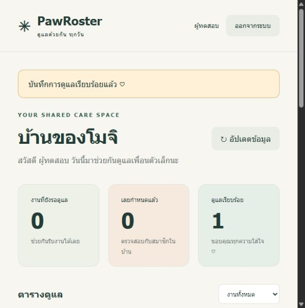

# PawRoster — ดูแลด้วยกัน ทุกวัน

ระบบแบ่งงานดูแลสัตว์เลี้ยงสำหรับคนที่อาศัยอยู่บ้านเดียวกัน: สร้างบ้าน → ชวนสมาชิก → เพิ่มสัตว์เลี้ยง → สร้างงานพร้อมกำหนดเวลา → รับงาน → ยืนยันการดูแล → ตรวจประวัติร่วมกัน

โครงงาน **PetTech × DevTools** ใช้ JavaScript, Node.js 24 และ SQLite โดยไม่มี npm dependencies สำหรับ runtime พร้อม Docker Compose, Jenkinsfile และหลักฐานจาก Course Container



## สถานะโครงการ

| ส่วน | สถานะ |
|---|---|
| Web + API + Database | Implemented และตรวจ HTTP/UI แล้ว |
| Automated HTTP tests | ผ่าน 9/9 ทั้ง Windows, Linux และ Course Container |
| Docker Compose / persistence / backup | ตรวจผ่านแล้ว |
| Jenkins | มี Pipeline; ยังต้องเชื่อม GitHub และรัน job จริง |
| GitHub repository | [67070282/PawRoster](https://github.com/67070282/PawRoster) · Private |
| สัมภาษณ์ผู้ใช้ / ผลกระทบ | รอเก็บข้อมูลจริง |

## โครงสร้าง Repository

```text
PawRoster/
├── src/server.js          # HTTP API, authentication, business rules, SQLite
├── public/                # หน้าเว็บ HTML/CSS/JavaScript
├── test/system.test.js    # HTTP acceptance tests
├── scripts/               # Backup, smoke และ Course Container verification
├── docs/                  # Proposal, architecture, operations และ presentation
├── evidence/              # ผลตรวจจริง รวม Course Container logs
├── .github/               # Issue และ Pull Request templates
├── compose.yaml
├── Dockerfile
├── Jenkinsfile
└── CONTRIBUTING.md
```

## สมาชิกผู้จัดทำ

| ชื่อ–นามสกุล | รหัสประจำตัว |
|---|---|
| นายคณุตม์ บัวชู | 67070206 |
| นายรชต มาลัยพงษ์ | 67070272 |
| นายรัชชานนท์ กิตติสัตยาวัจน์ | 67070273 |
| นายศรันย์ สุภาเพียร | 67070282 |

Section และหมายเลขกลุ่มยังไม่ระบุ รายละเอียดการแบ่งหน้าที่ดู docs/PROJECT.md

## เริ่มใช้เร็ว

ต้องมี Docker Engine และ Docker Compose v2:

```sh
docker compose up -d --build --wait
```

เปิด http://localhost:3080 แล้วสร้างบัญชีและบ้านใหม่ ไม่มีข้อมูลส่วนตัวหรือบัญชีเริ่มต้นในโค้ด สมาชิกถัดไปสมัครด้วยรหัสจาก “เชิญสมาชิกเข้าบ้าน” ไม่ควรแชร์รหัสนี้สาธารณะ

ถ้าพอร์ตชน: คัดลอก `.env.example` เป็น `.env` แล้วเปลี่ยน `APP_PORT` การทดสอบที่ผู้ช่วยทำไว้ใช้ Compose project `pawroster-review` และกำลังให้บริการที่พอร์ต 3080 หากต้องการใช้คอนเทนเนอร์เดิม ให้รัน `docker compose -p pawroster-review ...` แทนคำสั่งปกติ

### รันโดยไม่ใช้ Docker

ใช้ Node.js 24.14.x (มี `node:sqlite` ในตัว ไม่ต้อง npm install):

```sh
npm start
```

เปิด http://localhost:3000 ข้อมูลเก็บที่ `data/pawroster.db` SQLite อาจพิมพ์ ExperimentalWarning จาก Node ซึ่งไม่ใช่ผลทดสอบล้มเหลว

## สิ่งที่ทำได้

- สร้างบัญชี เข้าสู่ระบบ ออกจากระบบ และเข้าบ้านด้วยรหัสเชิญ
- แยกข้อมูลคนละบ้านด้วยสิทธิ์ที่ Backend ทุกคำขอ
- เพิ่มสัตว์เลี้ยงและสร้างงานครั้งเดียวพร้อมวันเวลา
- รับงานได้คนเดียว คืนงาน หรือบันทึกว่าเสร็จแล้วพร้อมหมายเหตุ
- เฉพาะผู้รับงานเปลี่ยนสถานะงานนั้นได้ ป้องกันทำเสร็จซ้ำ
- แสดงงานเลยกำหนด กรองงาน และดูประวัติผู้ทำรายการ 50 กิจกรรมล่าสุด
- บันทึกงานกับประวัติใน transaction เดียว ข้อมูลคงอยู่หลังรีสตาร์ต

ไม่ได้ใช้ LLM, อีเมล, push notification, งานเกิดซ้ำอัตโนมัติ, คำแนะนำการรักษา, การลบบัญชี หรือระบบหลายบ้านต่อบัญชี ไม่รับปากผลทางสุขภาพหรือจำนวนงานที่ลืมลดลงจนกว่าจะมีการศึกษากับผู้ใช้จริง

## การทดสอบและหลักฐาน

```sh
npm run check
npm test
docker compose config --quiet
docker compose ps
docker compose exec -T app node -e "fetch('http://127.0.0.1:3000/health').then(async r=>{if(!r.ok)process.exit(1);console.log(await r.text())})"
```

ดู [ผลตรวจ](evidence/VERIFICATION.md), [ผลทดสอบ Linux ฉบับเต็ม](evidence/linux-tests.tap) และ [ภาพหน้าเว็บ](evidence/dashboard.png)

ตรวจระบบใน Course Container `tuchsanai/devtools:2569_1` แล้ว: tests 9/9, Compose build/health, HTTP flow, backup/restore และข้อมูลหลัง recreate ผ่าน ดู [หลักฐาน Course Container](evidence/course/README.md)

**ยังไม่ใช่งานพร้อมส่งโดยไม่มีขั้นตอนเพิ่ม:** ต้องรัน Jenkins จริง ระบุ Section/หมายเลขกลุ่มและหน้าที่จริง เก็บหลักฐานปัญหาและผลจากผู้ใช้จริง รวมถึงสร้าง GitHub history/PR จากการทำงานของทีมตามจริง แล้วตรวจรุ่นส่งจาก commit ของ repository ทีมอีกครั้ง

## เอกสารสำหรับพัฒนาและนำเสนอ

- [Proposal, Acceptance Criteria และ Traceability](docs/PROJECT.md)
- [สถาปัตยกรรมและ API](docs/ARCHITECTURE.md)
- [ติดตั้ง Jenkins, Course Container, สำรองและกู้คืน](docs/OPERATIONS.md)
- [โครงเรื่องนำเสนอ 10 นาทีและ Demo](docs/PRESENTATION.md)
- [GitHub setup และ workflow ของทีม](docs/GITHUB.md)
- [แนวทางร่วมพัฒนา](CONTRIBUTING.md)

## แหล่งกติกา

- https://github.com/Tuchsanai/DevTools/tree/main/Mini_Project
- https://github.com/Tuchsanai/DevTools/tree/main/Mini_Project/project-details

อ้างอิงเนื้อหาที่อ่านวันที่ 27 ตุลาคม 2026 ให้ตรวจประกาศผู้สอนอีกครั้งก่อนส่ง

## AI disclosure

ใช้ OpenAI Codex ช่วยวิเคราะห์กติกา เลือกหัวข้อ ออกแบบ เขียนโค้ด ชุดทดสอบและเอกสารในชุดนี้ สมาชิกต้องอ่าน ทบทวน แก้ไข และอธิบาย data flow กับผลทดสอบได้ด้วยตนเอง การแบ่งงานในเอกสารเป็นข้อเสนอ ไม่ใช่หลักฐานว่าแต่ละคนทำงานนั้นแล้ว
