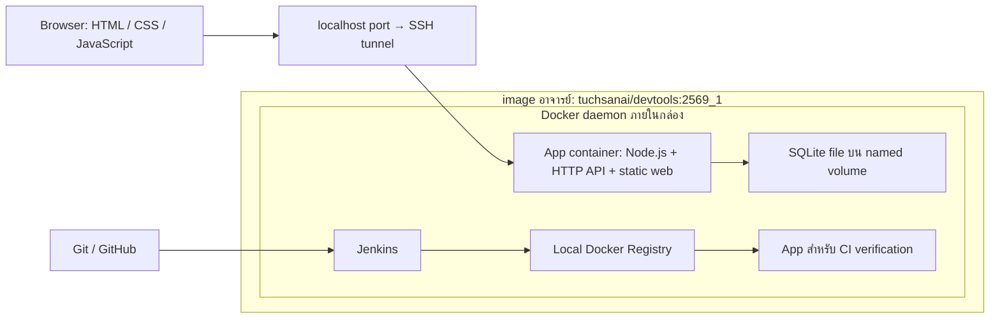

# สถาปัตยกรรม เทคโนโลยี และ API — PawRoster 2.3

อ้างอิง implementation รุ่น 2.3.0, schema 5 ใน repository นี้ รายงานผลตรวจอยู่ใน [RESEARCH.md](RESEARCH.md) และภาพหน้าจอปัจจุบันอยู่ใน [SCREENSHOTS.md](SCREENSHOTS.md)

## ภาพรวม

PawRoster เป็นเว็บแอปแบบ Monolith ขนาดเล็ก: หน้าเว็บและ HTTP API อยู่ใน app container เดียวกัน Node.js ประมวลผลกติกาธุรกิจและเปิดฐานข้อมูล SQLite แบบ embedded ข้อมูล SQLite เก็บบน named volume จึงแยกจากตัว image และการสร้าง container ใหม่

SQLite เป็นไฟล์ฐานข้อมูลและ library ที่ Node.js ใช้งานใน process ไม่ใช่ database server/container อีกตัว ส่วน Jenkins กับ registry เป็นชั้นส่งมอบ ไม่ใช่สิ่งที่ browser ต้องเรียกทุกครั้งที่ผู้ใช้กดปุ่ม

## ชั้นหน้าเว็บ

| เทคโนโลยี | ใช้อย่างไร | ประโยชน์ |
|---|---|---|
| HTML5 | โครงสร้างหน้า ฟอร์ม ตาราง รายการ และ dialog | ใช้ form validation และ semantic controls ของ browser ได้ |
| CSS3 / responsive layout | รูปแบบหน้าจอ ธีมสว่าง grid/flex และ media queries | ใช้งานได้ทั้งจอคอมและมือถือ โดยคงข้อความและปุ่มที่อ่านชัด |
| Vanilla JavaScript | รับ event แสดงสถานะ กรองข้อมูล ควบคุม dialog และปฏิทิน | หน้าเว็บโต้ตอบได้โดยไม่ต้องมี frontend framework หรือขั้น build เพิ่ม |
| Fetch API + JSON | เรียก API ของ server ส่งฟอร์มและอ่าน dashboard | เชื่อมข้อมูลจริงจาก backend แทนการแสดงข้อมูลตายตัว |
| SVG และฟอนต์ local | ภาพแมว สุนัข อุ้งเท้า และ Noto Sans Thai พร้อม fallback | รักษาธีมสัตว์เลี้ยงและอ่านข้อความไทย โดยไม่ต้องโหลดฟอนต์จาก CDN ขณะใช้งาน |
| Polling 30 วินาที | โหลดข้อมูลเมื่อหน้าเปิดอยู่และไม่มีฟอร์มกำลังแก้ไข พร้อมปุ่มอัปเดตเอง | สมาชิกเห็นความเปลี่ยนแปลงโดยไม่ต้องมี WebSocket server; ไม่ใช่ realtime ทันที |

ไฟล์หลักคือ `public/index.html`, `public/style.css`, `public/app.js` หน้าเว็บปัจจุบันไม่ได้ใช้ React, Vue หรือ Angular

## ชั้น Backend

| เทคโนโลยี/แนวทาง | ใช้อย่างไร | ประโยชน์ |
|---|---|---|
| Node.js 24.14.0 | รัน server และกติกาธุรกิจด้วย JavaScript | ใช้ภาษาเดียวกับ frontend และมีเครื่องมือมาตรฐานสำหรับ server/testing |
| node:http | สร้าง HTTP server ให้บริการไฟล์เว็บและ API | ลด dependency สำหรับโครงงานขนาดเล็ก ไม่ใช้ Express |
| HTTP JSON API | เช่น register/login/dashboard, pets/tasks/records/homes | แยกการแสดงผลออกจากการตรวจสิทธิ์และการเขียนข้อมูล |
| State machine ของงาน | open → claimed → done และ claimed → open | มีเงื่อนไขชัดว่าใครทำอะไรได้ ไม่เปลี่ยนสถานะตามใจจากหน้าเว็บ |
| Validation และขอบเขตบ้าน | ตรวจชนิดข้อมูล วันเวลา ความยาว ขนาด body และ membership | ลดข้อมูลผิดและป้องกันบัญชีบ้านอื่นเข้าถึงรายการผ่านการเดา ID |
| Structured stdout logs | บันทึก method/path/status/เวลาใช้ของคำขอ | ตรวจอาการและติดตามคำขอที่ผิดพลาดผ่าน docker logs ได้ |

ไฟล์หลักคือ `src/server.js` ปัจจุบันไม่มี runtime npm dependencies เพิ่มใน package.json ใช้ module มาตรฐานของ Node เป็นหลัก

## ฐานข้อมูลและความถูกต้อง

| เทคโนโลยี | ใช้อย่างไร | ประโยชน์ |
|---|---|---|
| SQLite ผ่าน node:sqlite | เก็บข้อมูลจริงเป็นไฟล์ `/app/data/pawroster.db` | ติดตั้งง่ายและทำ Transaction ได้ โดยไม่ต้องมี DB server แยก |
| Foreign keys | เชื่อมบ้าน ผู้ใช้ สัตว์ งานและบันทึก | ลดข้อมูลอ้างอิงที่ไม่มีต้นทาง |
| Parameterized SQL | แยกค่าที่รับจากผู้ใช้จากโครงสร้างคำสั่ง SQL | ป้องกัน input ถูกนำไปตีความเป็นคำสั่ง SQL โดยตรง |
| BEGIN IMMEDIATE / Transaction | ตรวจสถานะกับเขียนงาน/audit, เตะสมาชิก/บล็อก/หมุนรหัส และลบถาวรเป็นชุด | สำเร็จหรือย้อนกลับพร้อมกัน ป้องกันข้อมูลสำเร็จครึ่งชุดและการรับงานรายการเดียวซ้ำ |
| WAL และ busy_timeout | ตั้งค่าการทำงานของ SQLite ในการอ่าน/เขียนและรอ lock | ช่วยการใช้งานอ่าน/เขียนในขอบเขตระบบเล็ก แต่ไม่ได้ทำให้เป็นระบบหลาย replica |
| Versioned migrations | อัปเกรดฐานข้อมูลเดิมไป schema 5 ใน Transaction | เพิ่มฟีเจอร์โดยรักษาข้อมูลเดิมและตรวจเวอร์ชันก่อนเปิดแอป |
| Online backup + integrity checks | สร้างสำเนาฐานข้อมูล ตรวจ integrity และเทียบข้อมูล | พิสูจน์ว่าสำรองอ่านกลับได้ ไม่ใช่เพียงมีไฟล์ชื่อ backup |

ตารางหลัก 10 ตาราง:

| ตาราง | ข้อมูลที่เก็บ |
|---|---|
| homes | บ้าน รหัสเชิญ และสถานะรับสมาชิก |
| users | บัญชี ชื่อ อีเมลและข้อมูล hash รหัสผ่าน |
| memberships | ผู้ใช้เป็นสมาชิก/เจ้าของบ้านใด |
| sessions | hash ของ session และบ้านที่เลือกในแต่ละ session |
| pets | ข้อมูลสัตว์ สถานะเก็บประวัติ/ถังขยะ |
| tasks | งาน เวลา สถานะ ผู้รับ ความสำคัญและการทำซ้ำ |
| events | ประวัติการดำเนินงาน |
| pet_records | น้ำหนัก วัคซีน พบสัตวแพทย์ บันทึกและนัดหมาย |
| home_blocks | บัญชีที่ถูกบล็อกในแต่ละบ้าน |
| home_events | ประวัติการจัดการบ้านเฉพาะเจ้าของ |

## ความปลอดภัย

| กลไก | ประโยชน์และขอบเขต |
|---|---|
| scrypt + salt สุ่ม | เก็บ hash ของรหัสผ่าน ไม่เก็บรหัสผ่านตรง ๆ |
| Session สุ่มและเก็บ SHA-256 | ใช้ token ระบุตัวตน เก็บ hash ใน DB และมีวันหมดอายุ 24 ชั่วโมง |
| HttpOnly / SameSite=Strict cookie | จำกัดการอ่าน cookie จาก JavaScript และการส่งข้ามไซต์ใน browser |
| Membership + owner/member authorization | ตรวจสิทธิ์ตามบ้านทุกคำขอ ไม่พึ่งแค่ซ่อนปุ่ม |
| Origin check / CSP / frame restrictions / textContent | ลดความเสี่ยงคำขอข้ามเว็บไซต์ การรัน content ที่ไม่ตั้งใจ และการฝังหน้าเว็บ |
| Request size limit / throttling | จำกัดข้อมูลต่อคำขอและจำนวนครั้งการลอง login/register/join; ไม่ใช่ระบบป้องกัน DDoS |
| X-Home-ID และ reauthorization หลังอ่าน body | ป้องกันแท็บค้างเขียนผิดบ้าน และตรวจสิทธิ์ที่อาจเปลี่ยนขณะส่งข้อมูล |
| รหัสเชิญสุ่ม หมุนรหัส พักรับสมาชิก และ home_blocks | รหัสเก่าใช้ไม่ได้จริง และบัญชีที่ถูกบล็อกเข้ากลับไม่ได้จนปลดบล็อก |

ค่าตั้งต้นในห้องเรียนเป็น HTTP บน loopback ผ่าน SSH tunnel ถ้าเปิดบริการบนอินเทอร์เน็ตต้องจัด HTTPS และ COOKIE_SECURE=true หลัง HTTPS พร้อม ระบบยังไม่มี MFA หรือ email verification การบล็อกผูกกับบัญชี ไม่ใช่ตัวบุคคล

## Container และสภาพแวดล้อมอาจารย์

| ส่วน | ใช้อย่างไร | ประโยชน์ |
|---|---|---|
| Docker / Dockerfile | Build app จาก `node:24.14.0-alpine` | บรรจุ runtime และ source ที่ใช้รันให้ทำซ้ำได้ |
| Alpine Linux base image | ระบบ Linux ฐานของ app image | ได้สภาพแวดล้อม Linux ขนาดเล็กสำหรับแอป |
| Docker Compose | กำหนด build, port, environment, volume, health และ restart | เปิดระบบด้วย config เดียว ลดการพิมพ์คำสั่งตั้งค่าทีละส่วน |
| Named volume | เก็บ `/app/data` แยกจาก container | ข้อมูลยังอยู่เมื่อ recreate container ถ้าไม่ลบ volume |
| Non-root, read_only, tmpfs, cap_drop | แอปใช้ user node อ่าน image อย่างเดียว เขียนข้อมูล/ไฟล์ชั่วคราวในพื้นที่ที่กำหนด | ลดสิทธิ์และพื้นผิวที่ app container เขียนหรือใช้สิทธิ์พิเศษได้ |
| Docker HEALTHCHECK + /health | ตรวจว่าแอปตอบและอ่าน DB ได้ พร้อม version/revision | ช่วยตรวจการเริ่มบริการและรุ่นที่ deploy; ตรวจ business flow เพิ่มด้วย smoke tests |
| image อาจารย์ `tuchsanai/devtools:2569_1` | กล่องชั้นนอก เชื่อม `ssh root@localhost -p 2222` | ใช้สภาพแวดล้อมรายวิชาที่ผู้ตรวจทำซ้ำได้ |
| Docker-in-Docker | มี dockerd ภายในกล่องอาจารย์รัน app/CI containers ชั้นใน | ทดสอบและส่งมอบภายใน image อาจารย์ตามเงื่อนไข |
| SSH port forwarding | ส่ง localhost port ไปยังบริการในกล่อง | เปิดเว็บและ Jenkins จากเครื่องหลักได้โดยไม่เปลี่ยน mapping ทุกบริการของกล่องชั้นนอก |

กล่องอาจารย์ใช้ privileged เพื่อรองรับห้องเรียน จึงไม่ใช่ต้นแบบการแยกสิทธิ์สำหรับ production ทุกสถานการณ์ ส่วนสิทธิ์จำกัดข้างต้นเป็นของ app container ชั้นใน

## Source control และ CI/CD

| เทคโนโลยี | ประโยชน์ |
|---|---|
| Git | เก็บเวอร์ชัน diff และ commit ที่ย้อนตรวจได้ |
| GitHub / branches / Pull Requests | เผยแพร่ source, ตรวจการเปลี่ยนแปลงและรวมงานอย่างเป็นขั้นตอน |
| Jenkins | เรียกขั้นตอนตรวจ/build/publish/deploy อัตโนมัติหลัง source เปลี่ยน |
| Jenkinsfile / Groovy Pipeline | เก็บขั้นตอน CI/CD เป็นโค้ดใน repository จึงตรวจและแก้เวอร์ชันเดียวกับแอปได้ |
| SCM polling | Jenkins ตรวจการเปลี่ยนแปลงประมาณทุกสองนาที ไม่ต้องมี public webhook |
| Local registry `registry:2` | เก็บ app image หลัง build ที่ loopback ภายในกล่อง ก่อนนำไป deploy |
| Image tag / OCI labels / APP_REVISION | ระบุ job/build และ source commit ให้ตรวจว่า image กับโค้ดตรงกัน |
| JUnit XML / archived artifacts | เก็บผล tests, commit, health, image digest และ smoke ของแต่ละ build |
| Branch/failure gates | Feature branch ข้าม deploy และ verify ล้มเหลวแล้วไม่ส่งขั้น Build/Publish/Deploy ต่อ |

Pipeline จริง: Checkout → secret scan → syntax/HTTP tests → Compose validate → Build image → Publish image → main Deploy → health revision + HTTP smoke

Jenkins deploy ไป project สำหรับ CI แยกจากแอปใช้งาน/แอปสาธิต จึงต้องเทียบ health กับ commit ของ build เดียวกัน ไม่เอา revision ของคนละบริการมาเทียบกัน

## เครื่องมือทดสอบและช่วยพัฒนา

| เครื่องมือ | ใช้และมีประโยชน์อย่างไร |
|---|---|
| node:test + node:assert | Acceptance/integration tests เรียก API จริง ตรวจสิทธิ์ สถานะ ข้อมูลผิดและ persistence |
| HTTP smoke scripts | ตรวจ flow หลัง deploy ผ่านบริการจริง แทนตรวจเพียงว่า port เปิด |
| Edge + Playwright | Browser QA แยก owner/member ตรวจหน้าจอหลายขนาดและถ่ายภาพเว็บจริง เป็นการตรวจแยกจาก Jenkins pipeline ปัจจุบัน |
| Secret scan script | ตรวจ tracked files สำหรับ credential patterns และชนิดไฟล์อ่อนไหวที่กำหนด ไม่ใช่การรับรองว่าพบ secret ทุกชนิด |
| Shell / PowerShell scripts | ทำขั้นตอน course environment, verification, operations และการตรวจซ้ำให้ใช้คำสั่งชุดเดียวกันได้ |
| OpenAI Codex | เครื่องมือช่วยพัฒนา วิเคราะห์และจัดทำ tests/docs ไม่ใช่ LLM ที่แอปเรียกตอนผู้ใช้ใช้งาน |

## ตัวอย่างเส้นทางเมื่อผู้ใช้กดรับงาน

1. Browser ส่ง POST JSON ไป API พร้อม session cookie และ X-Home-ID
2. Node ตรวจ session, สมาชิกภาพ บ้าน และ input
3. เปิด Transaction ตรวจว่างานยัง open และอยู่ในบ้านที่เข้าถึงได้
4. เปลี่ยนเป็น claimed บันทึก assignee และเพิ่ม events
5. Commit แล้วตอบสำเร็จ หน้าเว็บอ่านข้อมูลใหม่และแสดงผู้รับ
6. ถ้ามีคนรับไปก่อน คำขอถัดมาได้ conflict แทนการเขียนทับ ถ้าขั้นตอนล้มเหลว Transaction ย้อนกลับทั้งชุด

คำอธิบายภาพรวม: “เราใช้เว็บแบบ Monolith หนึ่ง app container ที่ให้บริการหน้าเว็บและ Node.js API ใช้ SQLite บน named volume เพื่อเก็บข้อมูลถาวร และใช้ Transaction กับสิทธิ์แยกบ้านเพื่อความถูกต้อง ส่วน GitHub, Jenkins และ registry เป็นกระบวนการตรวจและส่งมอบ image ภายใน Docker ของอาจารย์ครับ”

## API catalog ของรุ่นปัจจุบัน

ทุก POST รับ JSON ขนาดไม่เกิน 16 KB ส่วน `/api/*` นอกจาก register/login ต้องมี session ที่ยังไม่หมดอายุ Server ตรวจบ้านและสิทธิ์จากฐานข้อมูล ไม่เชื่อ home_id หรือ role ที่ผู้ใช้ส่งมาแทน session

| Method | Path | Input / ผลและสิทธิ์ |
|---|---|---|
| GET | /health | ตรวจ DB → status, version, revision |
| POST | /api/register | name,email,password และ home หรือ invite → สร้างบัญชีและ session |
| POST | /api/login | email,password → session cookie |
| POST | /api/logout | เพิกถอน session ที่ใช้และล้าง cookie |
| GET | /api/dashboard | user, homes, members, pets, tasks, events, records; blocked_members/security_events เฉพาะ owner |
| GET | /api/homes | บ้านที่เป็นสมาชิกและ active_home_id |
| POST | /api/homes | name → สร้างบ้านและเลือกใช้งาน |
| POST | /api/homes/join | invite → เข้าร่วมด้วยบัญชีเดิม ตรวจรหัส การพักรับ และรายการบล็อก |
| POST | /api/homes/switch | home_id → เลือกบ้านที่เป็นสมาชิก เฉพาะ session ปัจจุบัน |
| POST | /api/homes/delete | owner + home_id, confirm_name, confirm_invite → ลบบ้านและข้อมูลของบ้านใน Transaction เดียว คงบัญชีและบ้านอื่นไว้ |
| POST | /api/homes/rename | owner + name → เปลี่ยนชื่อและ home audit |
| POST | /api/homes/invite/rotate | owner → รหัสใหม่; รหัสเก่าใช้ไม่ได้ทั้ง register/join |
| POST | /api/homes/invite/toggle | owner + enabled boolean → พัก/เปิดรับและเปลี่ยนรหัสใหม่ |
| POST | /api/homes/leave | member → ออกจากบ้านและคืนงานค้าง |
| POST | /api/homes/members/remove | owner + user_id ของสมาชิกอื่น → นำออก บล็อก คืนงาน หมุนรหัสและ audit ใน Transaction เดียว |
| POST | /api/homes/members/unblock | owner + user_id → ปลดบล็อกของบ้านนี้ ไม่เพิ่มสมาชิกกลับอัตโนมัติ |
| POST | /api/homes/transfer | owner + user_id ของสมาชิกอื่น → โอน owner และผู้โอนเป็น member |
| POST | /api/pets | name,species,notes?,breed?,birth_date?,sex? → สร้างสัตว์ในบ้าน |
| POST | /api/pets/:id/edit | แก้ข้อมูลสัตว์ที่ไม่อยู่ถังขยะภายในบ้าน |
| POST | /api/pets/:id/archive | owner + archived boolean → หยุดดูแล/นำกลับ ต้องไม่มีงานค้างก่อนเก็บประวัติ |
| POST | /api/pets/:id/delete | owner + confirm_name → ถังขยะและยกเลิกงานค้าง โดยคงประวัติ |
| POST | /api/pets/:id/restore | owner → กู้คืน ไม่เปิดงานที่ยกเลิกอัตโนมัติ |
| POST | /api/pets/:id/purge | owner + confirm_name + deleted_at ล่าสุด → ลบถาวรจากถังขยะพร้อมงาน บันทึกและประวัติของตัวนั้น |
| POST | /api/tasks | pet_id,title,due (ISO UTC),priority?,recurrence? → สร้างงาน |
| POST | /api/tasks/:id/edit | ผู้สร้าง/owner → แก้งานที่ยัง open |
| POST | /api/tasks/:id/cancel | ผู้สร้าง/owner → ยกเลิกงานที่ยังไม่เสร็จและคงประวัติ |
| POST | /api/tasks/:id/claim | สมาชิกบ้าน → open เป็น claimed โดยมีผู้รับเพียงหนึ่งคน |
| POST | /api/tasks/:id/release | ผู้รับงาน → claimed เป็น open |
| POST | /api/tasks/:id/complete | ผู้รับงาน + note? → done; สร้างงานซ้ำครั้งถัดไปใน Transaction เดียว |
| POST | /api/tasks/:id/assign | owner + user_id ของสมาชิกปัจจุบัน → มอบหมายงาน open |
| POST | /api/records | pet_id,kind,title,recorded_at,weight_kg?,due_at?,notes? → สร้างสมุดบันทึก |
| POST | /api/records/:id/edit | ผู้สร้าง/owner → แก้บันทึก; เปลี่ยนนัดรีเซ็ต resolved |
| POST | /api/records/:id/delete | ผู้สร้าง/owner → ลบบันทึกถาวร |
| POST | /api/records/:id/resolve | ผู้สร้าง/owner + resolved boolean → ทำเครื่องหมายนัดเสร็จ/เปิดกลับ |

## การรับมือข้อผิดพลาดและข้อแลกเปลี่ยน

| สถานการณ์ | พฤติกรรมที่กำหนด |
|---|---|
| ข้อมูลผิด/ไม่มี session/ไม่มีสิทธิ์ | HTTP 400/401/403 ตามเหตุผล |
| ไม่พบรายการหรือเป็นข้อมูลที่มองไม่เห็น | HTTP 404 |
| สถานะเปลี่ยน บ้านเปลี่ยน หรือคำขอชนกัน | HTTP 409 ไม่เขียนทับสถานะเดิม |
| Body ใหญ่เกิน/ชนิดข้อมูลไม่รองรับ/ลองถี่เกิน | HTTP 413/415/429 |
| DB หรือข้อผิดพลาดภายใน | HTTP 503 ข้อความทั่วไป พร้อมรายละเอียดที่ stdout; Transaction ย้อนกลับ |
| เครือข่ายขาด | UI แจ้งเชื่อมต่อไม่ได้ ไม่แสดงว่าสำเร็จก่อนรับ response |
| Connection หลุดหลัง server บันทึกแล้ว | ตรวจ dashboard ก่อนส่งซ้ำ เพราะงานสร้างไม่มี idempotency key |

การรับงานหนึ่งรายการซ้ำถูกป้องกันที่ Transaction แต่ระบบไม่ตรวจว่างานสองรายการมีความหมายซ้ำกัน และไม่ยืนยันการดูแลสัตว์ทางกายภาพ `scryptSync` และ `DatabaseSync` ทำงานแบบ synchronous จึงเหมาะขอบเขตหนึ่ง instance ขนาดเล็ก ไม่ใช่การออกแบบสำหรับ public high traffic หรือหลาย replica

ปฏิทินอ่าน `tasks.due` กับ `pet_records.due_at` แล้วแสดงตามเวลาท้องถิ่นของ browser งานซ้ำสร้างครั้งถัดไปหลัง Complete โดยนับจาก due เดิม 24 ชั่วโมง/7 วัน ไม่มี Cron, Push หรือการชดเชยรายการที่ตกหล่นอัตโนมัติ การส่งออก CSV เกิดใน browser ตามตัวกรองและทำให้ข้อความที่คล้ายสูตรเป็นข้อความ

## แผนที่ไฟล์และหลักฐาน

| ส่วนของระบบ | ไฟล์หลัก |
|---|---|
| Web UI / API client | [index.html](../public/index.html), [style.css](../public/style.css), [app.js](../public/app.js) |
| HTTP server / Auth / DB / Rules | [server.js](../src/server.js) |
| Image / Compose | [Dockerfile](../Dockerfile), [compose.yaml](../compose.yaml) |
| CI/CD | [Jenkinsfile](../Jenkinsfile), [jenkins](../jenkins/) |
| Acceptance tests | [test](../test/) |
| Course / Backup / Smoke | [scripts](../scripts/), [OPERATIONS.md](OPERATIONS.md) |
| ผลทดสอบและ source ที่ตรวจ | [RESEARCH.md](RESEARCH.md), [Course/API/UI 2.3](../evidence/home-deletion/README.md), [Jenkins](../evidence/submission-2.2/README.md) |
| ขอบเขตความปลอดภัย | [SECURITY.md](SECURITY.md) |

หลักฐานแต่ละชุดระบุวันที่และ commit ของรอบตรวจ เอกสารสถาปัตยกรรมอธิบาย implementation ปัจจุบัน ไม่ใช้ผลของรุ่นเก่ารับรอง feature ที่เพิ่มภายหลัง

## การลบบ้านและ schema 5

`users` เก็บบัญชีโดยไม่ผูกกับบ้านใดบ้านหนึ่ง สมาชิกภาพอยู่ใน `memberships` เท่านั้น Migration 4→5 ลบคอลัมน์เก่า `users.home_id` ด้วย Transaction และตรวจ foreign keys โดยคง id, ชื่อ, email, salt, password hash, sessions และสมาชิกภาพเดิมไว้ ฐานข้อมูลใหม่ยังผ่านลำดับ migration เดียวกัน

`POST /api/homes/delete` ตรวจ owner จาก session และตรวจสิทธิ์อีกครั้งหลังอ่าน request body จับคู่ home_id กับบ้านปัจจุบัน ชื่อบ้านที่พิมพ์ และรหัสเชิญที่ snapshot ตอนเปิด dialog จึงปฏิเสธ dialog ค้างหลังเปลี่ยนรหัสหรือสลับบ้าน การลบ events → tasks → pet_records → pets → blocks/history → memberships → home อยู่ใน Transaction เดียว ตั้ง active_home_id ของ session ที่เลือกบ้านนี้เป็น NULL หากขั้นใดผิดพลาด rollback ทั้งหมด

ไม่ลบ users หรือ session token และไม่เปลี่ยนข้อมูลบ้านอื่น เมื่ออ่าน dashboard ครั้งถัดไป auth เลือกสมาชิกภาพที่ยังเหลือ หรือคืนสถานะไม่มีบ้านให้สร้าง/เข้าร่วมใหม่ได้ ไม่มีการย้ายสัตว์เลี้ยงข้ามบ้านและไม่มีการกู้คืนบ้านจาก UI ดู [วิธีใช้](CARE-FEATURES.md#ลบบ้านถาวร-รุ่น-23) และ [ผล H1–H5](../evidence/home-deletion/README.md)
