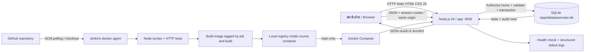

# สถาปัตยกรรมและการตัดสินใจ

Runtime มี **app container เดียว** รวม static web และ REST API ฐานข้อมูลเป็น SQLite embedded จริง ไม่ใช่ database container แยก ข้อมูลเก็บ named volume `care-data` container อ่าน image แบบ read-only และเขียนเฉพาะ volume กับ tmpfs ไม่ใช้ broker, proxy, LLM หรือบริการภายนอก

ชั้น CI ใช้ Jenkins และ registry แยกจาก app ภายใน Docker daemon ของ Course Container Jenkins ตรวจ SCM ทุก2นาที ไม่ต้องเปิด webhook ออกอินเทอร์เน็ต Image tag แยกตาม job/build และมี label commit; /health คืน revision ที่ build เพื่อตรวจหลัง deploy ว่ารุ่นตรงกับ checkout จริง workspace ของ Jenkins mount ที่ absolute path เดียวกันในกล่องและ controller เพื่อให้ inner Docker daemon เห็นไฟล์ build/test ถูกที่

registry ใช้ HTTP เฉพาะ loopback ภายในกล่องเพื่อห้องเรียน ไม่ใช่ public registry Jenkins มีบัญชี admin และ secret สุ่มที่เก็บนอก repository; ไม่ให้ anonymous อ่านหรือ build. Docker socket ที่ mount เป็นของ inner daemon ไม่ใช่ host Docker socket แต่กล่องรายวิชาแบบ privileged ยังมีสิทธิ์สูงและควรหยุดเมื่อเลิกใช้

HTTP ใช้ใน localhost/course lab; หากเปิดภายนอกต้องใช้ HTTPS reverse proxy ตั้ง `COOKIE_SECURE=true` และออกแบบ proxy/Origin ให้ตรงกับ host ที่ Browser เรียก ค่าเริ่มต้น bind แค่ loopback การเปลี่ยน `APP_BIND=0.0.0.0` ทำให้เครือข่ายเข้าถึงได้และต้องประเมินสิทธิ์และ firewall ก่อน

## ข้อมูล

- homes: ชื่อบ้าน + invite token สุ่ม 96 bits
- users: email unique, password hash scrypt + random salt, home_id
- sessions: เก็บ SHA-256 ของ token สุ่ม 192 bits หมดอายุ 24 ชั่วโมง; logout ลบจริง
- pets: home_id, name, species
- tasks: pet_id, title, UTC due, open/claimed/done, assignee, completed_at, note
- events: task_id, actor, action, UTC timestamp

Foreign key เปิดทุก connection; WAL กับ busy_timeout สำหรับงานอ่าน/เขียนขนาดเล็ก `BEGIN IMMEDIATE` ครอบ state validation, update และ audit เพื่อให้รายการเดียวกันไม่ถูกทำซ้ำ ใช้ instance เดียวกับ local volume ไม่รองรับ replica/shared network filesystem รุ่น schema=1 สร้างอัตโนมัติ หากเปลี่ยน schema ต้องเพิ่ม migration ที่ทดสอบการอัปเกรดก่อนส่ง

## HTTP API

ทุก POST รับ JSON ไม่เกิน 16 KB, ทุก `/api/*` นอกจาก register/login ต้องมี session

| Method | Path | Input / ผล |
|---|---|---|
| GET | /health | SELECT 1 → status, version |
| POST | /api/register | name,email,password,home หรือ invite → session cookie |
| POST | /api/login | email,password → session cookie |
| POST | /api/logout | {} → revoke session |
| GET | /api/dashboard | user,pets,tasks,events เฉพาะบ้าน |
| POST | /api/pets | name,species → id |
| POST | /api/tasks | pet_id,title,due (ISO UTC) → id |
| POST | /api/tasks/:id/claim | {} → open to claimed |
| POST | /api/tasks/:id/release | {} → claimed to open |
| POST | /api/tasks/:id/complete | note? (≤500) → claimed to done |

400 validation, 401 session, 403 permission/origin, 404 unseen entity, 409 state conflict, 413 oversized body, 415 media type, 429 authentication rate limit, 503 unexpected service/database error

## ความปลอดภัยและ Failure Modes

Cookie HttpOnly/SameSite Strict, Origin validation เมื่อ Browser ส่ง Origin, parameterized SQL, rendering user text ด้วย textContent, CSP same-origin และ no-store ช่วยลดความเสี่ยงที่เกี่ยวข้อง ไม่บันทึก password/cookie/body ลง access logs rate limit 30 ครั้งต่อนาทีต่อ IP อยู่ในหน่วยความจำ รีสตาร์ตแล้ว reset; scrypt แบบ synchronous อาจ block event loop จึงไม่เหมาะ public high traffic

คำขอชนได้ 409 พร้อม reload ใน UI; permission ผิดได้ 403; DB error ได้ข้อความทั่วไปและรายละเอียดใน stdout; network ขัดข้อง UI แจ้ง error ผู้ใช้กดอัปเดตใหม่หลังเชื่อมต่อได้ ไม่แสดงผลสำเร็จก่อนรับ response งานสร้างไม่มี idempotency key จึงไม่ควรกดส่งใหม่โดยไม่ตรวจ dashboard ถ้า connection หลุดหลังบันทึก งานที่สมาชิกสร้างซ้ำเชิงความหมายยังเป็นข้อจำกัด

## เส้นทาง Demo

Browser กดรับงาน → POST JSON + cookie → sessions lookup → home_id authorization → BEGIN IMMEDIATE → ตรวจ open → update claimed/assignee + insert event → COMMIT → JSON → Browser โหลด dashboard → แสดงผู้รับผิดชอบ เมื่อคนที่สองกดรับงานเก่าจะได้ 409 ไม่มี event เพิ่ม
