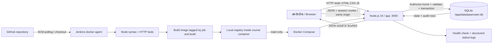

# สถาปัตยกรรมและการตัดสินใจ

Runtime มี **app container เดียว** รวม static web และ REST API ฐานข้อมูลเป็น SQLite embedded จริง ไม่ใช่ database container แยก ข้อมูลเก็บ named volume `care-data` container อ่าน image แบบ read-only และเขียนเฉพาะ volume กับ tmpfs ไม่ใช้ broker, proxy, LLM หรือบริการภายนอก

ชั้น CI ใช้ Jenkins และ registry แยกจาก app ภายใน Docker daemon ของ Course Container Jenkins ตรวจ SCM ทุก2นาที ไม่ต้องเปิด webhook ออกอินเทอร์เน็ต Image tag แยกตาม job/build และมี label commit; /health คืน revision ที่ build เพื่อตรวจหลัง deploy ว่ารุ่นตรงกับ checkout จริง workspace ของ Jenkins mount ที่ absolute path เดียวกันในกล่องและ controller เพื่อให้ inner Docker daemon เห็นไฟล์ build/test ถูกที่

registry ใช้ HTTP เฉพาะ loopback ภายในกล่องเพื่อห้องเรียน ไม่ใช่ public registry Jenkins มีบัญชี admin และ secret สุ่มที่เก็บนอก repository; ไม่ให้ anonymous อ่านหรือ build. Docker socket ที่ mount เป็นของ inner daemon ไม่ใช่ host Docker socket แต่กล่องรายวิชาแบบ privileged ยังมีสิทธิ์สูงและควรหยุดเมื่อเลิกใช้

HTTP ใช้ใน localhost/course lab; หากเปิดภายนอกต้องใช้ HTTPS reverse proxy ตั้ง `COOKIE_SECURE=true` และออกแบบ proxy/Origin ให้ตรงกับ host ที่ Browser เรียก ค่าเริ่มต้น bind แค่ loopback การเปลี่ยน `APP_BIND=0.0.0.0` ทำให้เครือข่ายเข้าถึงได้และต้องประเมินสิทธิ์และ firewall ก่อน

## ข้อมูล

- homes: ชื่อบ้าน + invite token สุ่ม 96 bits และ invite_enabled สำหรับพักรับสมาชิก
- home_blocks: บัญชีที่ถูกบล็อกแยกตามบ้าน ผู้บล็อกและเวลา
- home_events: ประวัติการจัดการบ้านเฉพาะเจ้าของ ไม่บันทึกรหัสเชิญหรือ session token
- users: email unique, password hash scrypt + random salt; home_id เดิมเก็บไว้เพื่อรองรับฐานข้อมูลเก่า ไม่ใช้เป็นแหล่งสิทธิ์
- memberships: คู่ home_id/user_id และ role owner/member เป็นแหล่งสิทธิ์การเข้าถึงบ้าน
- sessions: เก็บ SHA-256 ของ token สุ่ม 192 bits หมดอายุ 24 ชั่วโมง; active_home_id แยกตาม Session; logout ลบจริง
- pets: home_id, name, species, notes, archived, deleted_at, breed, birth_date, sex
- pet_records: pet_id, created_by, kind, title, recorded_at, weight_kg, due_at, notes, resolved_at, updated_at
- tasks: pet_id, title, UTC due, open/claimed/done, assignee, completed_at, note, created_by, priority, recurrence, cancelled_at
- events: task_id, actor, action, UTC timestamp และ detail สำหรับผู้รับมอบหมาย

Foreign key เปิดทุก connection; WAL กับ busy_timeout สำหรับงานอ่าน/เขียนขนาดเล็ก `BEGIN IMMEDIATE` ครอบ state validation, update และ audit เพื่อให้รายการเดียวกันไม่ถูกทำซ้ำ ใช้ instance เดียวกับ local volume ไม่รองรับ replica/shared network filesystem schema ปัจจุบันคือ 4 สำหรับการจัดการสมาชิก ส่วน schema 3 เพิ่มสมุดบันทึก ถังขยะ และข้อมูลสัตว์เลี้ยง โดยอัปเกรดแต่ละเวอร์ชันใน Transaction แยกกัน; schema 2 อัปเกรดจากรุ่น 1 ใน Transaction เดียว โดยเก็บข้อมูลและ Session เดิม ผู้ใช้คนแรกของแต่ละบ้านเดิมเป็นเจ้าของบ้าน สมาชิกคนอื่นเป็น member การเปิดครั้งถัดไปจะไม่สร้าง membership ที่ออกจากบ้านแล้วกลับมาใหม่ มี Migration regression test M9

## HTTP API

ทุก POST รับ JSON ไม่เกิน 16 KB, ทุก `/api/*` นอกจาก register/login ต้องมี session

| Method | Path | Input / ผล |
|---|---|---|
| GET | /health | SELECT 1 → status, version |
| POST | /api/register | name,email,password,home หรือ invite → session cookie |
| POST | /api/login | email,password → session cookie |
| POST | /api/logout | {} → revoke session |
| GET | /api/dashboard | user,homes,members,pets,tasks,events เฉพาะบ้านที่เลือก |
| GET | /api/homes | บ้านที่เป็นสมาชิกและ active_home_id |
| POST | /api/homes | name → สร้างบ้านและเลือกใช้งาน |
| POST | /api/homes/join | invite → เข้าร่วมบ้านด้วยบัญชีเดิม |
| POST | /api/homes/switch | home_id → เปลี่ยนบ้านเฉพาะ Session |
| POST | /api/homes/rename | name → เจ้าของบ้านเปลี่ยนชื่อ |
| POST | /api/homes/invite/rotate | {} → เจ้าของบ้านเปลี่ยนรหัสเชิญ |
| POST | /api/homes/leave | {} → สมาชิกออกและคืนงานค้าง |
| POST | /api/homes/members/remove | user_id → เจ้าของบ้านนำสมาชิกออก |
| POST | /api/homes/transfer | user_id → โอนสิทธิ์เจ้าของบ้าน |
| POST | /api/pets | name,species,notes? → id |
| POST | /api/pets/:id/edit | name,species,notes? → แก้ไข |
| POST | /api/pets/:id/archive | archived (boolean) → เจ้าของบ้านเก็บประวัติ/นำกลับ |
| POST | /api/tasks | pet_id,title,due (ISO UTC),priority?,recurrence? → id |
| POST | /api/tasks/:id/edit | title,due,priority?,recurrence? → แก้ไขงาน open โดยผู้สร้าง/เจ้าของบ้าน |
| POST | /api/tasks/:id/cancel | {} → ยกเลิกงานที่ยังไม่เสร็จ โดยเก็บประวัติ |
| POST | /api/tasks/:id/claim | {} → open to claimed |
| POST | /api/tasks/:id/release | {} → claimed to open |
| POST | /api/tasks/:id/complete | note? (≤500) → claimed to done; งานซ้ำสร้างรายการถัดไปใน Transaction เดียว |

400 validation, 401 session, 403 permission/origin, 404 unseen entity, 409 state conflict, 413 oversized body, 415 media type, 429 authentication rate limit, 503 unexpected service/database error

## ความปลอดภัยและ Failure Modes

Cookie HttpOnly/SameSite Strict, Origin validation เมื่อ Browser ส่ง Origin, parameterized SQL, rendering user text ด้วย textContent, CSP same-origin และ no-store ช่วยลดความเสี่ยงที่เกี่ยวข้อง ไม่บันทึก password/cookie/body ลง access logs rate limit 30 ครั้งต่อนาทีต่อ IP อยู่ในหน่วยความจำ รีสตาร์ตแล้ว reset; scrypt แบบ synchronous อาจ block event loop จึงไม่เหมาะ public high traffic

คำขอชนได้ 409 พร้อม reload ใน UI; permission ผิดได้ 403; DB error ได้ข้อความทั่วไปและรายละเอียดใน stdout; network ขัดข้อง UI แจ้ง error ผู้ใช้กดอัปเดตใหม่หลังเชื่อมต่อได้ ไม่แสดงผลสำเร็จก่อนรับ response งานสร้างไม่มี idempotency key จึงไม่ควรกดส่งใหม่โดยไม่ตรวจ dashboard ถ้า connection หลุดหลังบันทึก งานที่สมาชิกสร้างซ้ำเชิงความหมายยังเป็นข้อจำกัด

UI ส่ง `X-Home-ID` บนคำขอแก้ไข Server เปรียบเทียบกับบ้านใน Session เพื่อป้องกันแท็บเก่า และตรวจสิทธิ์ซ้ำหลังอ่าน JSON body เผื่อถูกถอนสิทธิ์ระหว่างส่งคำขอ สมาชิกเห็นชื่อและบทบาทของคนในบ้าน โดยไม่ส่งอีเมลสมาชิกอื่น รหัสเชิญแสดงเฉพาะเจ้าของบ้าน การนำสมาชิกออกไม่ทำให้รหัสเชิญเดิมหมดอายุ จึงมีเมนูเปลี่ยนรหัสสำหรับกรณีจำกัดการเข้าร่วมใหม่

งานซ้ำสร้างครั้งถัดไปเมื่อ Complete สำเร็จเท่านั้น กำหนดเวลานับจาก due เดิม +24 ชั่วโมงหรือ +7 วัน ไม่ใช่ Cron และไม่ชดเชยรายการที่ตกหล่นโดยอัตโนมัติ การยกเลิกงานไม่สร้างรายการถัดไป

## เส้นทาง Demo

Browser กดรับงาน → POST JSON + cookie → sessions lookup → home_id authorization → BEGIN IMMEDIATE → ตรวจ open → update claimed/assignee + insert event → COMMIT → JSON → Browser โหลด dashboard → แสดงผู้รับผิดชอบ เมื่อคนที่สองกดรับงานเก่าจะได้ 409 ไม่มี event เพิ่ม

## API เพิ่มเติมรุ่น 2.1

| Method | Path | สิทธิ์และผล |
|---|---|---|
| POST | /api/pets/:id/delete | owner + confirm_name ตรงชื่อ → ย้ายถังขยะ ยกเลิกงานค้างพร้อม audit |
| POST | /api/pets/:id/restore | owner → นำกลับมาดูแล ไม่เปิดงานที่ยกเลิก |
| POST | /api/records | สมาชิกในบ้าน → สร้างบันทึกของสัตว์ที่ยังไม่อยู่ถังขยะ |
| POST | /api/records/:id/edit | ผู้บันทึกหรือ owner → แก้รายละเอียดและรีเซ็ตสถานะเมื่อเปลี่ยนนัด |
| POST | /api/records/:id/delete | ผู้บันทึกหรือ owner → ลบบันทึกถาวร |
| POST | /api/records/:id/resolve | ผู้บันทึกหรือ owner → resolved boolean สำหรับรายการที่มี due_at |
| POST | /api/tasks/:id/assign | owner → สมาชิกปัจจุบันของบ้าน รับงาน open พร้อม audit ชื่อผู้รับ |

Dashboard ส่ง records เฉพาะบ้านปัจจุบัน ปฏิทินรวม tasks.due กับ pet_records.due_at ใน Browser ตามเวลาท้องถิ่น โดยไม่มี Scheduler/Push การส่งออก CSV ใช้ข้อมูลตามตัวกรองใน Browser และเติม apostrophe หน้าข้อความที่เริ่มเหมือนสูตร Spreadsheet

### ลบสัตว์เลี้ยงถาวร

`POST /api/pets/:id/purge` รับ `confirm_name` และ `deleted_at` จากข้อมูลถังขยะล่าสุด ตรวจเจ้าของบ้าน ขอบเขตบ้าน ชื่อ และสถานะใน Transaction จากนั้นลบ events → tasks → pet_records → pets ตาม Foreign key โดยไม่เปลี่ยน schema ถ้าเกิดข้อผิดพลาดจะ Rollback ทั้งชุด สัตว์เลี้ยงต้องอยู่ในถังขยะก่อน ไม่มีการลบตามเวลา และไม่ลบไฟล์สำรองของผู้ดูแล

## รุ่น 2.2: การจัดการสมาชิกและ schema 4

เพิ่ม homes.invite_enabled, home_blocks และ home_events โดย migration 3 → 4 แบบ Atomic คงข้อมูลเดิม schema 3 เป็นเวอร์ชันของสมุดบันทึกก่อนหน้า

- `POST /api/homes/members/remove` นำออก บล็อก คืนงาน เปลี่ยนรหัส และ audit ใน Transaction เดียว
- `POST /api/homes/members/unblock` รับ user_id ตรวจบ้านและเจ้าของ ปลดบล็อกโดยไม่สร้างสมาชิกภาพ
- `POST /api/homes/invite/toggle` รับ enabled แบบ boolean พัก/เปิดรับสมาชิกโดยเปลี่ยนรหัสใหม่
- Dashboard ส่ง blocked_members และ security_events ให้เจ้าของบ้านเท่านั้น สมาชิกได้รายการว่าง
- รหัสเก่าและรหัสของบ้านที่พักรับสมาชิกใช้ไม่ได้ทั้ง register และ homes/join

รายละเอียด: [SECURITY.md](SECURITY.md)
