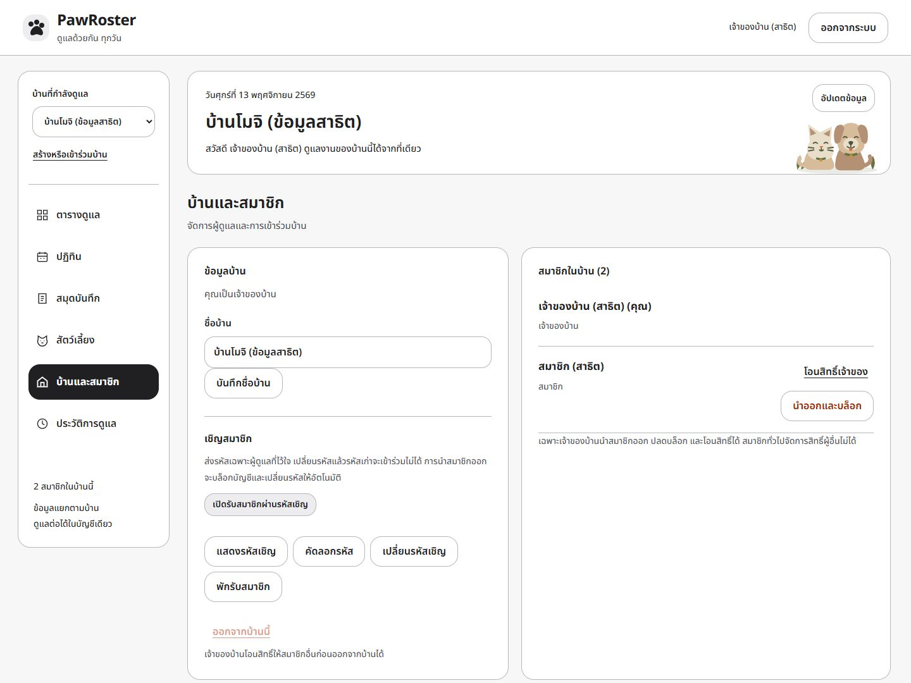
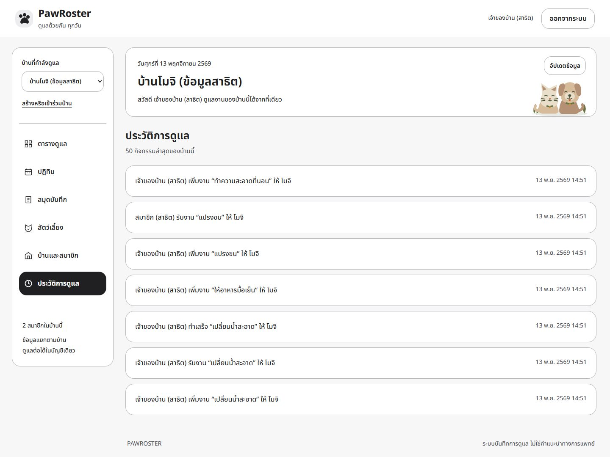
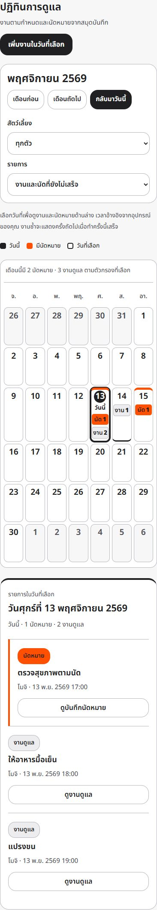

# ภาพหน้าจอ PawRoster 2.2

ถ่ายจากแอปรุ่น 2.2.0 ที่รันจริงใน Docker ของอาจารย์ผ่าน SSH tunnel วันที่ 13 พฤศจิกายน 2569 ใช้บัญชีและข้อมูลสาธิตที่สร้างแยกจากข้อมูลใช้งาน จอคอม 1440×1080 และมือถือ 390×844 ภาพที่จับเฉพาะ section อาจมีความสูงมากกว่า viewport เพื่อให้เห็นรายละเอียดครบ

ธีมปัจจุบันใช้พื้นขาว/เทาอ่อน ตัวอักษรเข้ม และสีส้มสำหรับนัดหมาย ภาพเหล่านี้ใช้แสดงหน้าจอ ไม่ใช่สถิติหรือผลการดูแลสัตว์จริง [ข้อมูลการจับภาพ](screenshots/v2.2/capture.json) ระบุ version และ revision ของแอป

## เข้าสู่ระบบและสร้างบัญชี

เริ่มบ้านใหม่หรือเข้าร่วมบ้านด้วยรหัสเชิญ

## ตารางดูแล

ดูจำนวนงาน สถานะ ผู้รับผิดชอบ ค้นหาและกรองงาน

## ปฏิทินงานและนัดหมาย

วันนี้มีวงกลมเลขวันและป้ายวันนี้ วันที่มีนัดมีแถบส้ม วันที่เลือกมีกรอบเข้ม รายละเอียดรายวันแสดงด้านข้างบนจอกว้าง

## สมุดบันทึกสัตว์เลี้ยง

เลือกสัตว์เพื่อดูน้ำหนักล่าสุดและประวัติ กรองประเภทและส่งออก CSV ได้

## สัตว์เลี้ยงในบ้าน

ดูข้อมูลประจำตัว หมายเหตุ สมุดบันทึก และคำสั่งจัดการตามสิทธิ์

## บ้านและสมาชิก

เจ้าของบ้านจัดการรหัสเชิญ พักรับสมาชิก โอนสิทธิ์ นำออกและบล็อก และปลดบล็อกได้ รหัสซ่อนอยู่ในภาพ

## ประวัติการดูแล

ตรวจผู้ดำเนินการ การเปลี่ยนสถานะ และเวลาของงานในบ้าน

## ปฏิทินบนมือถือ

ยังเห็นวันนี้และจำนวนงาน/นัดอย่างชัดเจน รายละเอียดวันที่เลือกอยู่ด้านล่าง

