# ภาพหน้าจอ PawRoaster

ถ่ายจากแอปรุ่น 2.3.0 ที่รันจริงใน Docker ของอาจารย์ผ่าน SSH tunnel ของแอปสาธิต localhost:3084 วันที่ 13 พฤศจิกายน 2569 ใช้บัญชีและข้อมูลสาธิตที่สร้างแยกจากข้อมูลใช้งาน จอคอม 1440×1080 และมือถือ 390×844 ภาพที่จับเฉพาะ section อาจมีความสูงมากกว่า viewport เพื่อให้เห็นรายละเอียดครบ

ธีมปัจจุบันใช้พื้นขาว/เทาอ่อน ตัวอักษรเข้ม และสีส้มสำหรับนัดหมาย ภาพเหล่านี้ใช้แสดงหน้าจอ ไม่ใช่สถิติหรือผลการดูแลสัตว์จริง [ข้อมูลการจับภาพ](screenshots/current/capture.json) ระบุ version และ revision ของแอป

## เข้าสู่ระบบและสร้างบัญชี

เริ่มบ้านใหม่หรือเข้าร่วมบ้านด้วยรหัสเชิญ

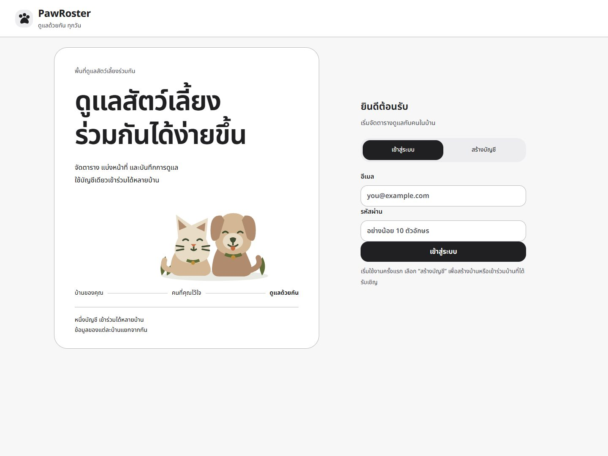

## ตารางดูแล

มุมมองเริ่มต้น “ยังไม่เสร็จถึงวันนี้” รวมงานค้างและงานครบกำหนดวันนี้ งานของวันถัดไปอยู่ใน “งานล่วงหน้า / รอบถัดไป” ดูจำนวนงาน สถานะ ผู้รับผิดชอบ ค้นหาและกรองงาน

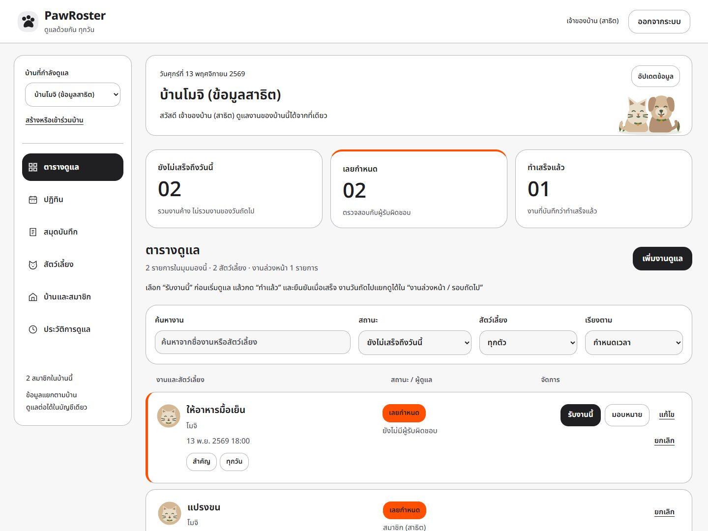

## ปฏิทินงานและนัดหมาย

วันนี้มีวงกลมเลขวันและป้ายวันนี้ วันที่มีนัดมีแถบส้ม วันที่เลือกมีกรอบเข้ม รายละเอียดรายวันแสดงด้านข้างบนจอกว้าง

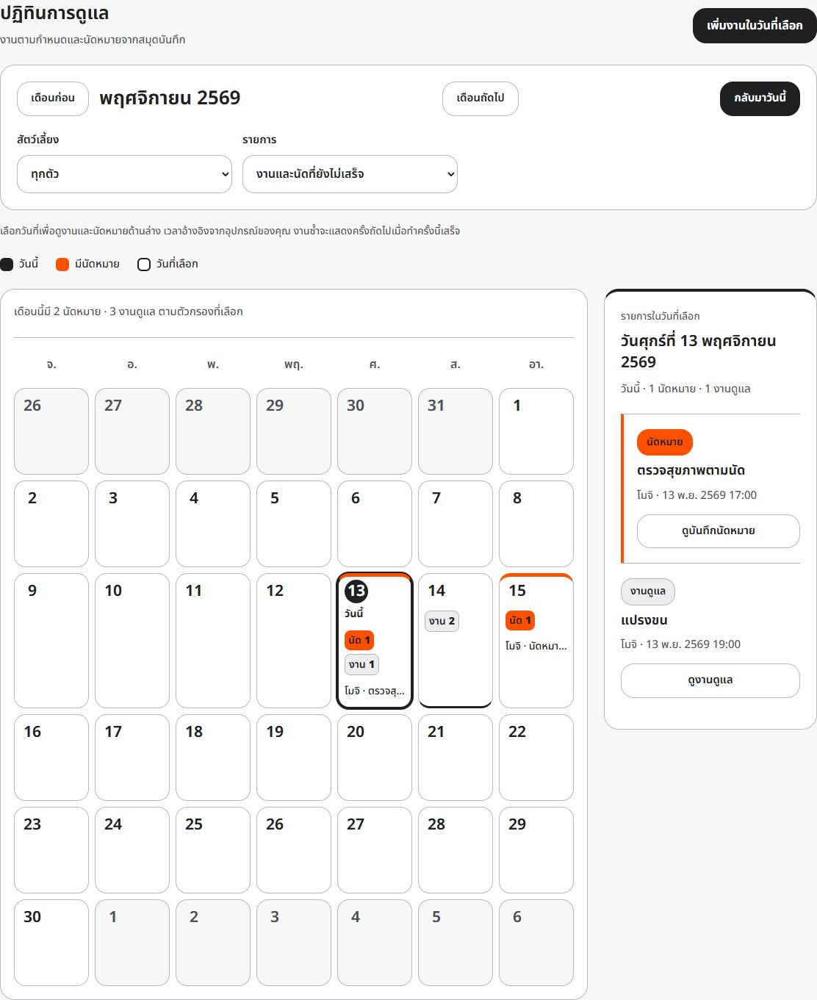

## สมุดบันทึกสัตว์เลี้ยง

เลือกสัตว์เพื่อดูน้ำหนักล่าสุดและประวัติ กรองประเภทและส่งออก CSV ได้

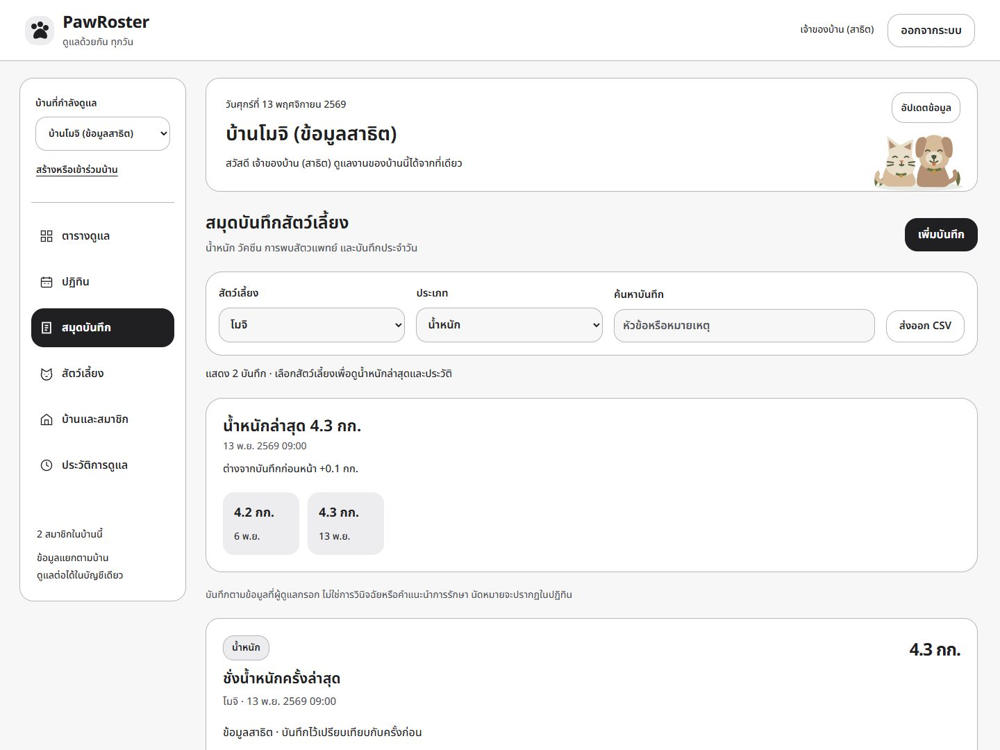

## สัตว์เลี้ยงในบ้าน

ดูข้อมูลประจำตัว หมายเหตุ สมุดบันทึก และคำสั่งจัดการตามสิทธิ์

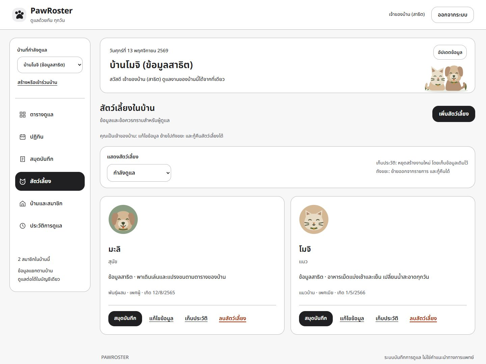

## บ้านและสมาชิก

เจ้าของบ้านจัดการรหัสเชิญ พักรับสมาชิก โอนสิทธิ์ นำออกและบล็อก และปลดบล็อกได้ รหัสซ่อนอยู่ในภาพ

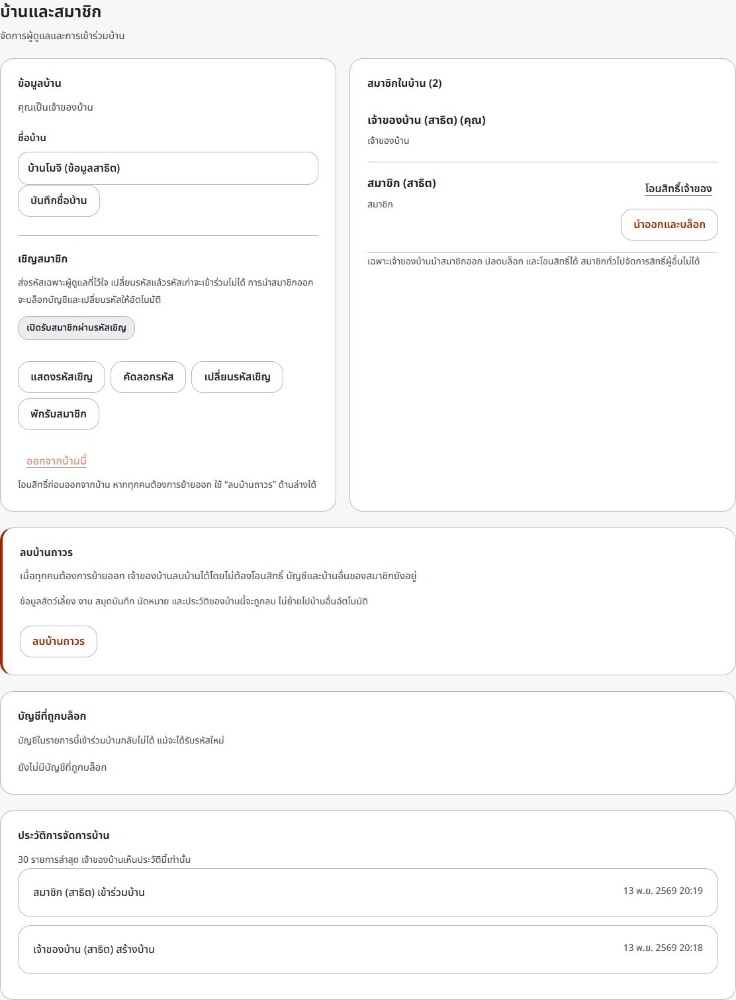

## ประวัติการดูแล

ตรวจผู้ดำเนินการ การเปลี่ยนสถานะ และเวลาของงานในบ้าน

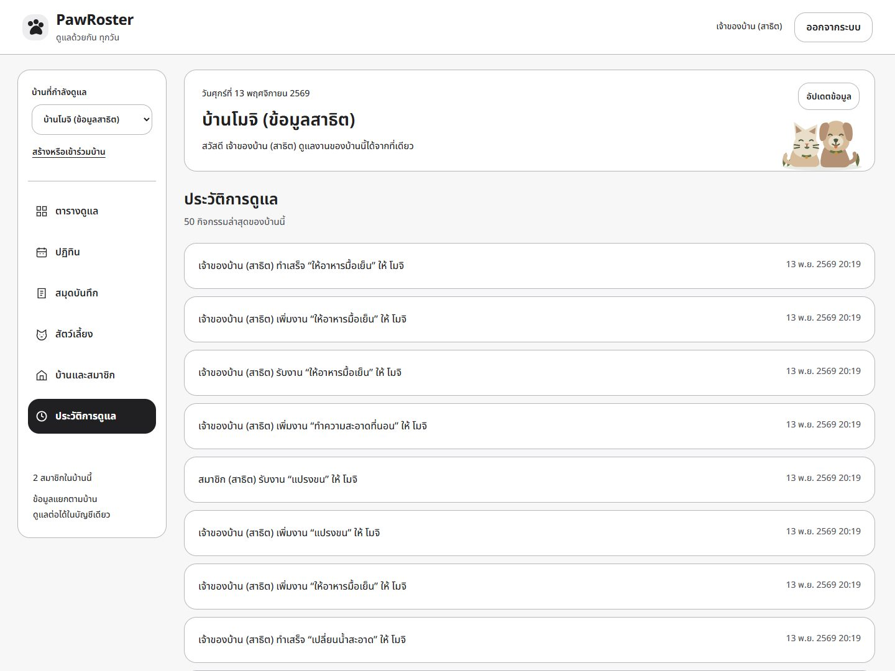

## ปฏิทินบนมือถือ

ยังเห็นวันนี้และจำนวนงาน/นัดอย่างชัดเจน รายละเอียดวันที่เลือกอยู่ด้านล่าง

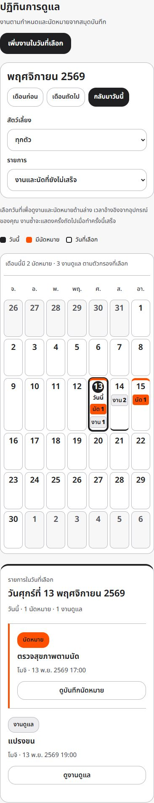

## ยืนยันลบบ้านถาวร

เจ้าของต้องพิมพ์ชื่อบ้านและยืนยันหลังอ่านข้อความผลกระทบ บัญชีและบ้านอื่นคงอยู่

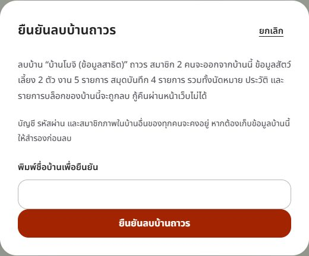

## หลังยืนยันว่าทำแล้ว

งานเดิมย้ายไป “ทำแล้ว” ข้อความแจ้งผลบอกกำหนดของงานรอบถัดไปพร้อมปุ่มเปิดรายการ งานวันถัดไปแยกจากงานค้างถึงวันนี้ แม้กดอัปเดตข้อมูลซ้ำ

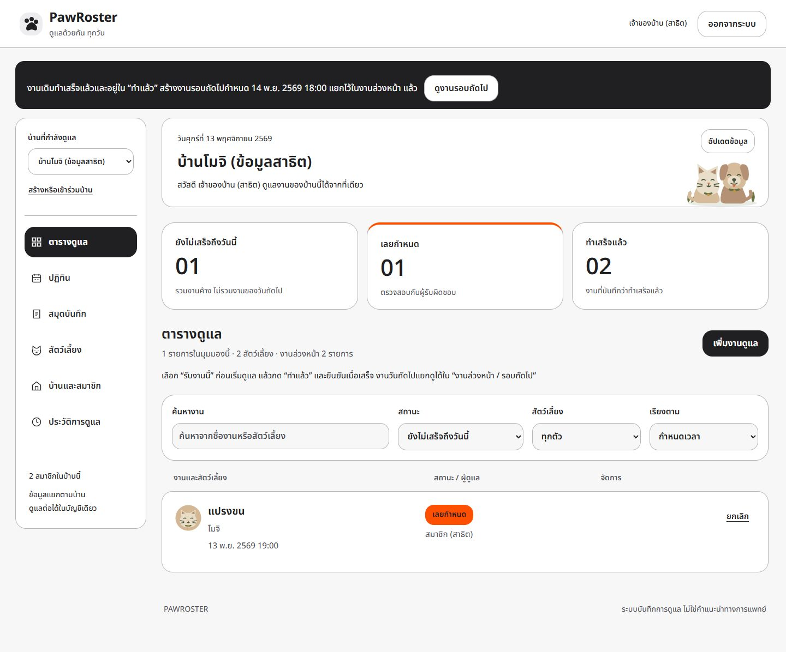

## งานล่วงหน้าและรอบถัดไป

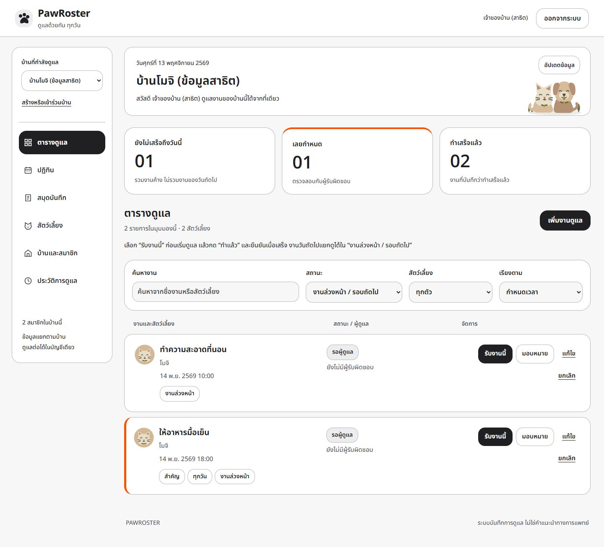

## รายการที่ทำแล้ว

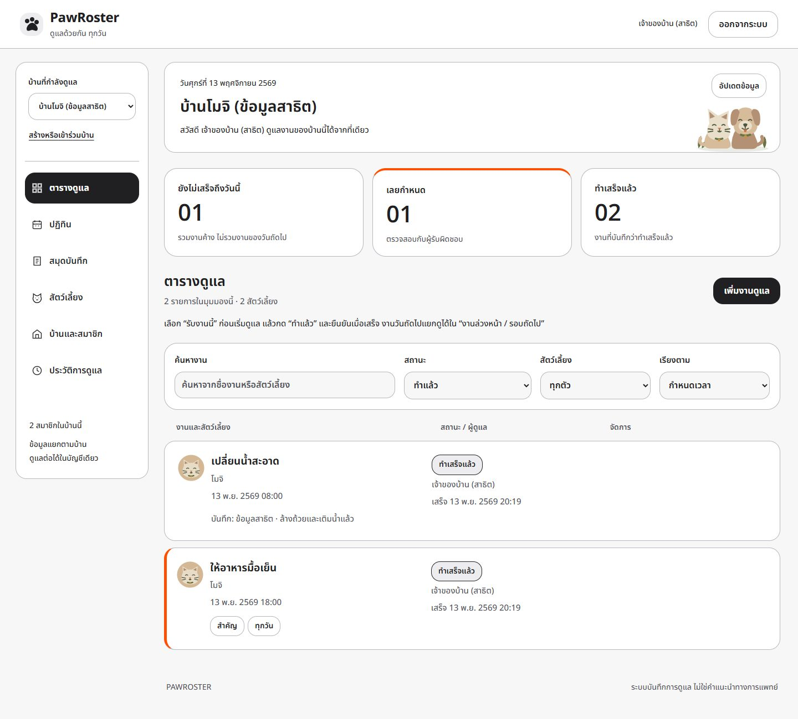
