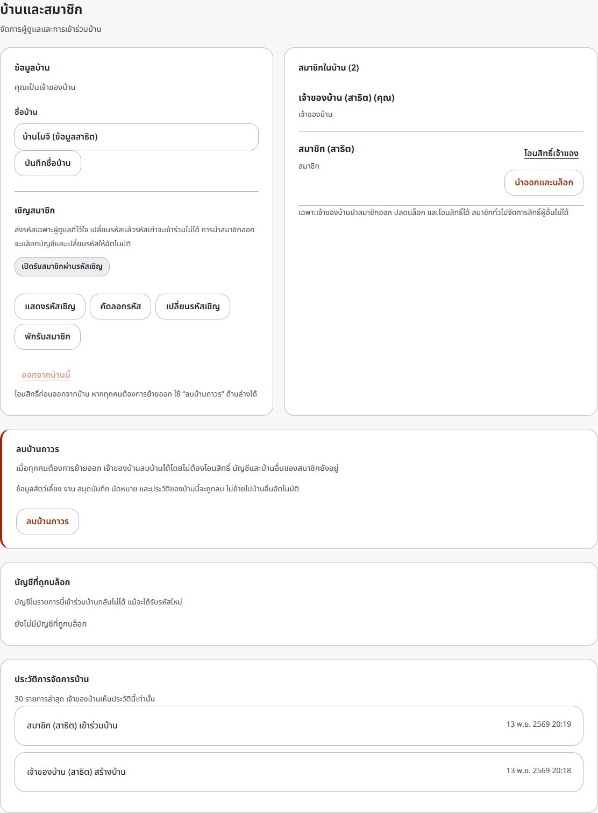

# ความปลอดภัยและการจัดการสมาชิก

## การจัดการบ้าน

เจ้าของบ้านใช้เมนู **บ้านและสมาชิก** เพื่อจัดการได้ดังนี้:

| การกระทำ | ผล |
|---|---|
| เปลี่ยนรหัสเชิญ | รหัสเก่าใช้ไม่ได้ทันที ทั้งสมัครใหม่และบัญชีเดิมที่ขอเข้าร่วม สมาชิกเดิมยังใช้งานได้ |
| พักรับสมาชิก | ปิดการเข้าร่วมด้วยรหัสทุกบัญชี สมาชิกเดิมยังดูแลได้ |
| เปิดรับสมาชิกอีกครั้ง | สร้างรหัสใหม่ ไม่กลับไปใช้รหัสก่อนพัก |
| นำออกและบล็อก | ลบสมาชิกภาพของบ้าน ตัดสิทธิ์การเรียก API ของบ้านในทุก session คืนงานค้าง บล็อกการเข้าร่วมกลับด้วยบัญชีนั้น และเปลี่ยนรหัสเชิญใน Transaction เดียว |
| ปลดบล็อก | อนุญาตให้บัญชีนั้นใช้รหัสปัจจุบันเข้าร่วมใหม่ ไม่เพิ่มกลับอัตโนมัติ |
| โอนสิทธิ์เจ้าของ | สมาชิกที่เลือกเป็นเจ้าของแทน ผู้โอนกลายเป็นสมาชิก ไม่สามารถจัดการสิทธิ์คนอื่นต่อ |

บัญชีที่ออกจากบ้านเองไม่ถูกบล็อก เจ้าของบ้านนำตัวเองออกไม่ได้จนกว่าจะโอนสิทธิ์ สมาชิกทั่วไปไม่เห็นรหัสเชิญ รายการบล็อก หรือประวัติการจัดการ และเรียก API จัดการสิทธิ์เองไม่ได้ ตรวจสิทธิ์จากฐานข้อมูลทุกคำขอ รวมถึงตรวจอีกครั้งหลังอ่าน request body

รหัสถูกซ่อนจากหน้าจอจนกว่าจะกดแสดง การซ่อนนี้ช่วยลดการเห็นรหัสบนจอ ไม่ได้แทนที่การตรวจสิทธิ์ใน API ประวัติการจัดการบ้านบันทึกผู้กระทำ ผู้เกี่ยวข้อง ประเภท และเวลา 30 รายการล่าสุดสำหรับเจ้าของบ้าน โดยไม่เก็บรหัสเชิญ รหัสผ่าน หรือ session token ในประวัติ

## หน้าจอจัดการบ้านปัจจุบัน

ภาพใช้ข้อมูลสาธิตและซ่อนรหัสเชิญ ดู [ภาพหน้าจอทั้งหมด](SCREENSHOTS.md)

## สิ่งที่มีในระบบ

- รหัสผ่านเก็บเป็น scrypt พร้อม salt สุ่ม ไม่เก็บรหัสผ่านตรง ๆ
- Session สุ่ม เก็บ hash ฝั่งฐานข้อมูล ใช้ HttpOnly / SameSite=Strict หมดอายุ 24 ชั่วโมง และ logout เพิกถอน session ที่ใช้
- จำกัดการลอง login/register/join ตาม IP, ใช้ parameterized SQL และจำกัดขนาด request body
- ตรวจ Origin สำหรับคำขอเปลี่ยนข้อมูลที่มี Origin header, CSP, no-store, ป้องกัน iframe และใช้ textContent แสดงข้อมูลผู้ใช้
- ข้อมูลและสิทธิ์แยกตามบ้าน ป้องกันการเขียนจากแท็บที่ค้างอยู่คนละบ้าน

## ขอบเขตของการประเมิน

ตรวจจากโค้ดและ acceptance/browser tests ไม่ใช่การทดสอบเจาะระบบโดยผู้ตรวจอิสระ จึงไม่อ้างว่าปลอดภัยครบทุกด้าน

- กล่องเรียนใช้ HTTP บน localhost ผ่าน SSH tunnel หากเปิดบริการบนอินเทอร์เน็ตต้องจัด HTTPS และตั้ง COOKIE_SECURE=true หลัง HTTPS พร้อมใช้งาน ตาม [OWASP Session Management](https://cheatsheetseries.owasp.org/cheatsheets/Session_Management_Cheat_Sheet.html)
- ยังไม่มีการยืนยันอีเมล MFA หรือระบบอนุมัติตัวตน การบล็อกผูกกับบัญชี ไม่สามารถรับประกันการห้ามบุคคลเดิมที่สร้างบัญชีใหม่ได้ พักรับสมาชิกเมื่อไม่ต้องการรับคนเพิ่ม
- ตัดสิทธิ์ API ทันทีเมื่อการนำออกสำเร็จ แต่เรียกคืนข้อมูลที่ผู้ใช้เคยดาวน์โหลดหรือเห็นแล้วไม่ได้ หน้าจอเก่าอาจแสดงข้อมูลเดิมจนกว่าจะ refresh หรือรอบอัปเดตอัตโนมัติ
- Rate limit อยู่ในหน่วยความจำของ instance เดียว ไม่ใช่ระบบป้องกัน DDoS และไม่ได้แทนการควบคุมที่ reverse proxy

## ฐานข้อมูลและการตรวจสอบ

schema 3 → 4 เพิ่ม homes.invite_enabled, home_blocks และ home_events แบบ Atomic โดยรักษารหัสบ้านเดิม สมาชิก Session สัตว์เลี้ยงและประวัติเดิม สำรองก่อนอัปเกรด ใช้ไฟล์ก่อนอัปเกรดหากต้องย้อนกลับโค้ดรุ่นเก่า

S1–S6 ครอบคลุมรหัสเก่าทั้งสองช่องทาง การตัดสิทธิ์หลาย session การบล็อก/ปลดบล็อก การพักรับสมาชิก ขอบเขตบ้าน Rollback และ migration/persistence รวมกับ R/M/C/H เป็น 37 กรณี (38 TAP records รวม parent) ผลตรวจอยู่ใน [RESEARCH](RESEARCH.md) และ [หลักฐานลบบ้าน](../evidence/home-deletion/README.md)

## ลบบ้านถาวร

เจ้าของบ้านเปิด **บ้านและสมาชิก → ลบบ้านถาวร** แล้วพิมพ์ชื่อบ้านให้ตรงและกดยืนยัน สมาชิกทั่วไปไม่มีสิทธิ์ลบบ้าน หากทุกคนต้องการย้ายออก ไม่จำเป็นต้องโอนเจ้าของให้คนที่ต้องอยู่ต่อ

การลบจะนำสมาชิกทุกคนออกและลบสัตว์เลี้ยงทุกสถานะ งาน สมุดบันทึก นัดหมาย ประวัติ และรายการบล็อกของบ้านนั้นถาวร รหัสเชิญเดิมใช้ไม่ได้ ข้อมูลไม่ย้ายไปบ้านใหม่อัตโนมัติ และกู้คืนผ่านหน้าเว็บไม่ได้ หากต้องเก็บข้อมูล ให้ผู้ดูแลสำรองฐานข้อมูลก่อนลบตาม [OPERATIONS.md](OPERATIONS.md)

บัญชี รหัสผ่าน และสมาชิกภาพในบ้านอื่นยังอยู่ ผู้ใช้ที่มีบ้านอื่นจะดูแลบ้านที่เหลือต่อได้ ผู้ที่ไม่มีบ้านเหลือยังเข้าสู่ระบบและเปิด **จัดการบ้าน** เพื่อสร้างบ้านหรือใช้รหัสเข้าร่วมบ้านอื่นได้ สมาชิกที่เปิดหน้าเดิมไว้กดอัปเดตข้อมูลเพื่อดูสถานะล่าสุด
