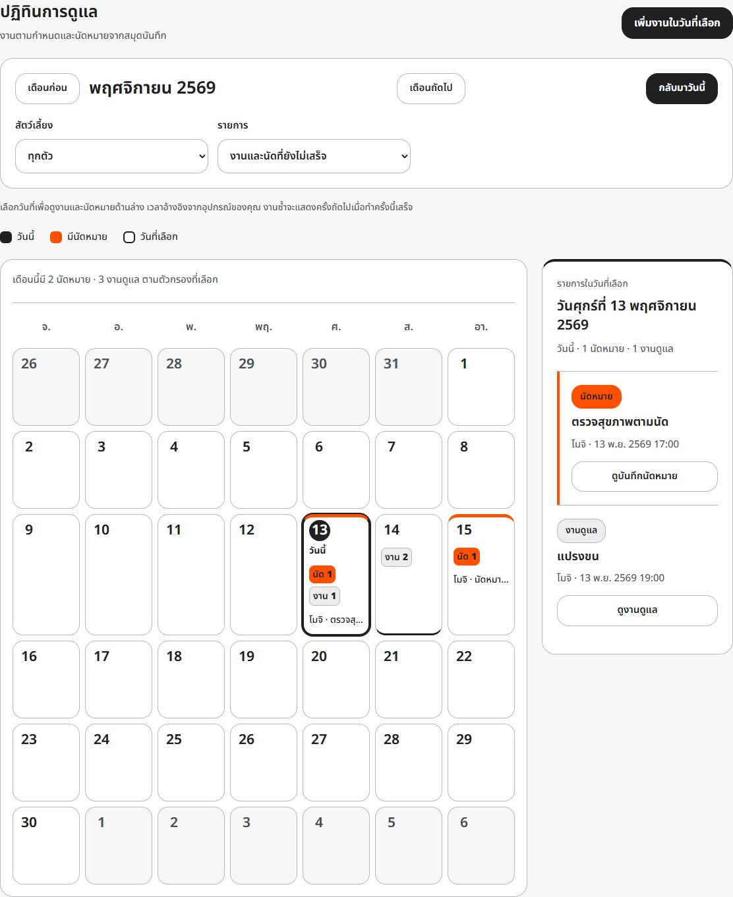

# การออกแบบหน้าจอให้อ่านและใช้งานง่าย

> ระบบใช้ schema 5 และรองรับลบบ้านโดยเจ้าของ โดยคงบัญชีและบ้านอื่นไว้ ดู [วิธีใช้งาน](CARE-FEATURES.md) และ [ผลตรวจระบบ](../evidence/home-deletion/README.md)

PawRoaster ใช้ธีมสัตว์เลี้ยงแนว Swiss: พื้นขาว/เทาอ่อน ข้อความเข้ม และสีส้ม #FF4F00 สำหรับนัดหมายและจุดที่ต้องสังเกต โดยเน้นข้อความสีเข้ม ขอบช่องกรอกที่เห็นชัด และปุ่มหลักที่แยกจากการแก้ไขหรือลบข้อมูล

- ข้อความทั่วไป 16px และข้อความช่วยเหลืออย่างน้อย 14px ใช้ Noto Sans Thai สำหรับภาษาไทยและ Helvetica/Arial สำหรับอักษรที่เหลือ
- สถานะงานแสดงทั้งข้อความและสี ได้แก่ รอผู้ดูแล กำลังดูแล เลยกำหนด ทำเสร็จแล้ว และยกเลิกแล้ว
- การ์ดงานและสัตว์เลี้ยงบนมือถือเรียงคอลัมน์เดียว ปุ่มมีความสูงอย่างน้อย 44px และมีเส้นแสดงตำแหน่งโฟกัสเมื่อใช้คีย์บอร์ด
- หน้าเริ่มต้นที่ยังไม่มีสัตว์เลี้ยงมีปุ่มเพิ่มสัตว์เลี้ยง และตารางดูแลอธิบายขั้นตอนรับงานก่อนบันทึกว่าทำแล้ว
- ปฏิทินมีปุ่ม “ดูงานดูแล” และ “ดูบันทึกนัดหมาย” เพื่อบอกปลายทางของแต่ละรายการ
- สมุดบันทึกแสดงจำนวนรายการตามตัวกรองและวิธีดูประวัติน้ำหนัก

## ปฏิทินและธีมสว่าง

- วันนี้มีวงกลมสีเข้มรอบเลขวัน พร้อมป้าย “วันนี้” และ `aria-current=date`
- วันที่มีนัดมีแถบสีส้มและจำนวน “นัด” งานดูแลแยกป้าย “งาน” และแสดงทั้งสองแบบได้ในวันเดียว
- วันที่เลือกมีกรอบเข้มแยกจากการเป็นวันนี้
- ยอดรวมเดือนนับตามเดือนและตัวกรองที่เลือก รายละเอียดวันแสดงข้างปฏิทินบนจอกว้างและด้านล่างบนจอเล็ก
- ปุ่มกลับมาวันนี้ และลูกศร/Home/End เลื่อนวันและข้ามเดือนได้โดยรักษาโฟกัส
- หน้าหลักทั้งหมดใช้ธีมเดียวกัน โดยเก็บภาพประกอบแมว สุนัข และอุ้งเท้าไว้

## ผลตรวจธีมปัจจุบัน

Edge/Playwright ใช้บัญชีและข้อมูลสังเคราะห์ใน context แยก หน้าหลัก 6 หน้าไม่ล้นที่ 320/390/680/1365px และปฏิทินตรวจเพิ่มที่ 1024/1440px ข้อความในชุดตรวจมีความต่างสีต่ำสุด 4.93:1 ไม่พบ page errors และผ่าน keyboard focus/navigation หลักฐานอยู่ใน [evidence/calendar-highlights](../evidence/calendar-highlights/README.md) การตรวจนี้ไม่ใช่การรับรอง WCAG ครบทุกข้อ

การจัดการสมาชิกและถังขยะ/ลบถาวรตรวจเพิ่มตาม [RESEARCH.md](RESEARCH.md) ภาพทุกหน้ารุ่นปัจจุบันอยู่ใน [SCREENSHOTS.md](SCREENSHOTS.md) หลักฐานใน evidence/ui-readability และ evidence/v2.1 เป็นประวัติของธีมก่อนหน้า
