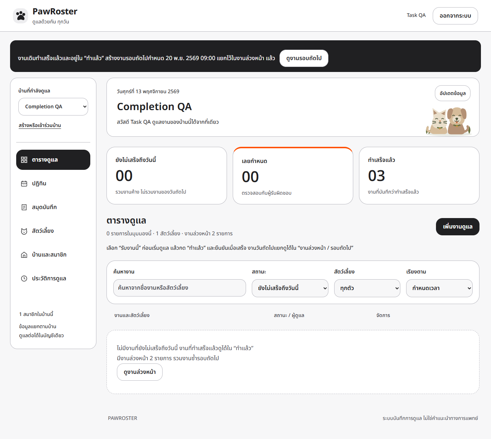

# ตรวจการปิดงานและแยกงานรอบถัดไป

ตรวจวันที่ 13 พฤศจิกายน 2569 ใช้ข้อมูลสังเคราะห์ Source runtime/tests `8bd56c2b787345a549bfe9cb15e717e3b014580f` ส่วนเอกสารและหลักฐานเพิ่มหลัง source นี้

## อาการและผลแก้

ก่อนแก้ เมื่อปิดงานรายวัน API บันทึกงานเดิมเป็น done แล้ว แต่หน้า “งานที่ยังไม่เสร็จ” แสดงรายการใหม่ชื่อเดียวกันของวันถัดไป จึงดูคล้ายงานเดิมไม่หาย [ผลจำลองก่อนแก้](before.json)

มุมมองเริ่มต้นเปลี่ยนเป็น “ยังไม่เสร็จถึงวันนี้” รวมงานค้างตามเวลาท้องถิ่น ส่วนรายการวันถัดไปแสดงใน “งานล่วงหน้า / รอบถัดไป” หลังยืนยันจะแจ้งว่างานเดิมเสร็จแล้วและบอกกำหนดของรายการใหม่ พร้อมปุ่มเปิดรอบถัดไป งานครั้งเดียวไม่มีรายการเพิ่ม และงานเดิมยังดูได้ใน “ทำแล้ว”

การคำนวณวันซ้ำยังอิงกำหนดเดิม 24 ชั่วโมง/7 วัน หากรอบใหม่เป็นวันที่ผ่านมา รายการใหม่นั้นยังแสดงเป็นงานค้างตามกำหนด ไม่ข้าม backlog อัตโนมัติ ไม่แก้หรือลบประวัติการทำงานเดิม

## ผลตรวจ

| รายการ | ผลและหลักฐาน |
|---|---|
| Windows Node.js 24.14.0 | 37 กรณี / 38 TAP records รวม parent ผ่าน fail 0 [TAP](windows-tests.tap) |
| Linux ใน image อาจารย์ | ชุดเดียวกันผ่าน [TAP](course-tests.tap) / [commit](course-commit.txt) |
| M7 | ตรวจ completed_task_id และ next_task สำหรับงานครั้งเดียว รายวัน รายสัปดาห์ พร้อมปฏิเสธการปิดซ้ำ |
| Browser QA | ปิดแล้วกดอัปเดต รอดูในทำแล้ว/งานล่วงหน้า สร้างงานอนาคต ขอบเขตวันตาม timezone และ 320/390/1365px ผ่าน [ผล](browser-qa.json) |
| Course Docker-in-Docker | Build, revision health, HTTP smoke, backup และ force-recreate persistence ผ่าน [ผล](course-smoke.txt) / [Compose](course-compose.txt) |

