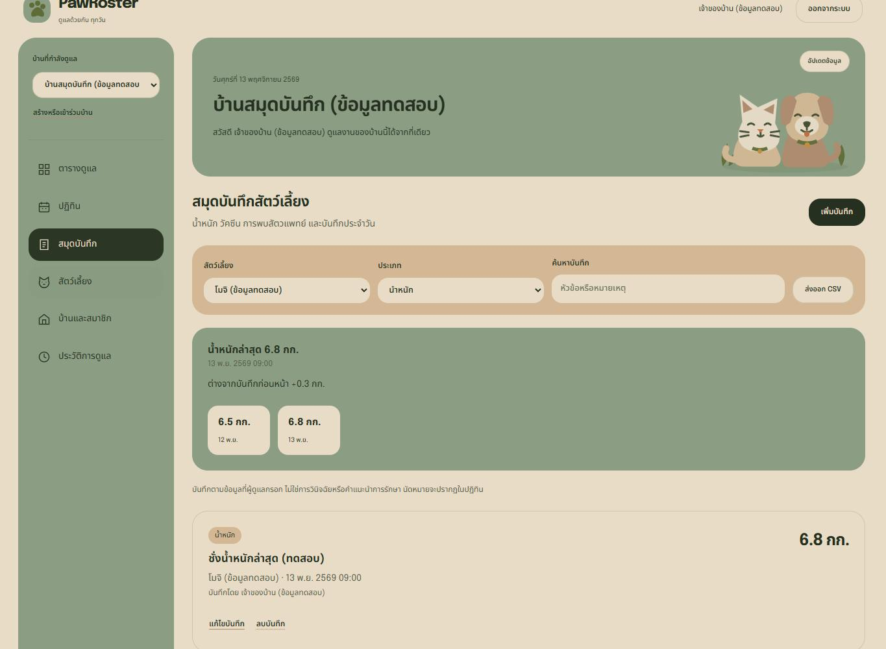
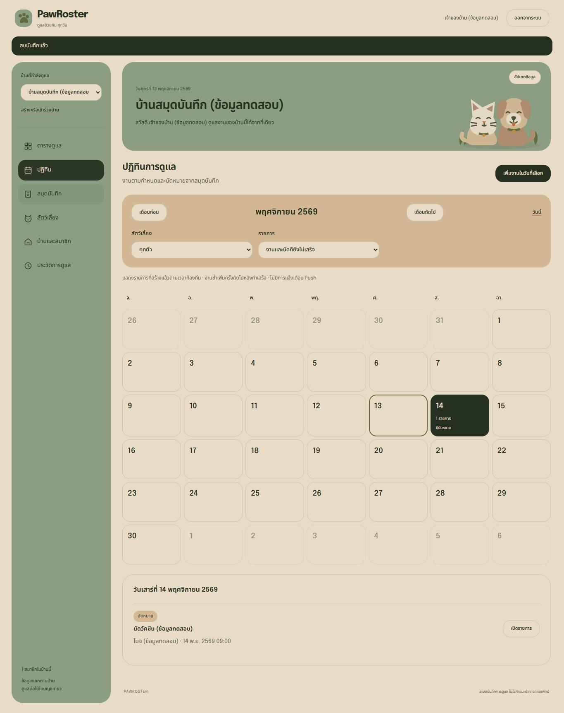

> ประวัติการตรวจตามวันที่และ commit ในเอกสารนี้ หลักฐานรุ่นปัจจุบันดู [แผนที่หลักฐาน](../README.md)

# ผลตรวจ PawRoster 2.1

วันที่ตรวจ: 13 พฤศจิกายน 2026

## ขอบเขตฟีเจอร์

ถังขยะสัตว์เลี้ยงและการกู้คืน, สายพันธุ์/เพศ/วันเกิด, สมุดบันทึกและน้ำหนัก, นัดหมาย, ปฏิทินรายเดือน, งานที่มอบหมายให้สมาชิก และส่งออก CSV ดู [รายละเอียดและสิทธิ์](../../docs/CARE-FEATURES.md)

## ผลตรวจที่บันทึกไว้

- [Windows HTTP tests](windows-tests.tap): 24 กรณี R1–R8, M1–M9 และ C1–C7 ผ่าน รวม 25 TAP records เมื่อรวม Parent
- [Browser UI summary](ui-summary.json): ผ่านการเพิ่ม/แก้ไข/ลบบันทึก, น้ำหนักล่าสุดและความต่าง, CSV ที่ไม่ประมวลผลเป็นสูตร, นัดหมายเสร็จ/เปิดกลับ, ปฏิทินและการเลื่อนเดือน, สร้างงานในวันที่เลือก, มอบหมายให้สมาชิก, พิมพ์ชื่อยืนยันลบสัตว์เลี้ยง/กู้คืน และสิทธิ์ของ member
- ตรวจปฏิทิน สมุดบันทึก สัตว์เลี้ยง และฟอร์มที่ความกว้าง 390px ไม่พบ Horizontal overflow หรือ JavaScript page errors
- Browser QA ใช้ Edge แบบแยกโปรไฟล์กับข้อมูลสังเคราะห์ ผ่าน SSH tunnel ไปยังแอปใน Docker daemon ภายในกล่องอาจารย์ โดยรอบ UI นี้ใช้ working tree ที่ revision `worktree-2.1`

## ภาพหน้าจอ

ข้อมูลทุกบ้าน บัญชี สัตว์เลี้ยง น้ำหนัก และนัดหมายในภาพเป็นข้อมูลทดสอบ

## ข้อจำกัดของหลักฐาน

ผล Windows/UI ข้างต้นไม่ใช่ผล Jenkins รุ่น 2.1 และไม่ใช่ผลทดลองกับผู้เลี้ยงจริง ผล Course verification จาก GitHub commit จะบันทึกแยกจากรอบ UI ที่ตรวจ Working tree

## Course verification จาก GitHub ผ่าน SSH

Clone feature branch ที่ Commit **03a66b28cb324d23ce05a6b19c0fefaa4d1cce65** ผ่าน SSH ใน image อาจารย์ แล้วรัน `scripts/course-verify.sh` ด้วย Compose project แยก `pawroster-care-validation` และ Volume แยกจากข้อมูลเดิม ผล Exit = 0

- [Source commit](course-commit.txt) และ [Working tree](course-worktree.txt) ว่างก่อนตรวจ
- [Course tests](course-tests.tap): 24 กรณี / 25 TAP records ผ่านทั้งหมด
- [Smoke/Persistence/Backup](course-smoke.txt): หลายบ้าน งานซ้ำ สมุดบันทึก นัดหมาย ถังขยะ/กู้คืน และข้อมูลหลัง Force-recreate ผ่าน
- [Health](course-health.json): version 2.1.0 และ Revision ตรง Commit ที่ Clone/Build
- [Daemon proof](daemon-proof.json): outer image ถูกต้อง, privileged, ไม่ใช้ host socket และ daemon สองชั้นแยกกัน (app health ยืนยันแยกใน Health ของ project ทดสอบ)

การเพิ่มหลักฐานภายหลังไม่เปลี่ยนโค้ดแอปที่ตรวจใน Commit นี้ ยังไม่ได้รัน Jenkins รุ่น 2.1 ใหม่ และยังไม่มีผลศึกษาจากผู้เลี้ยงจริง
