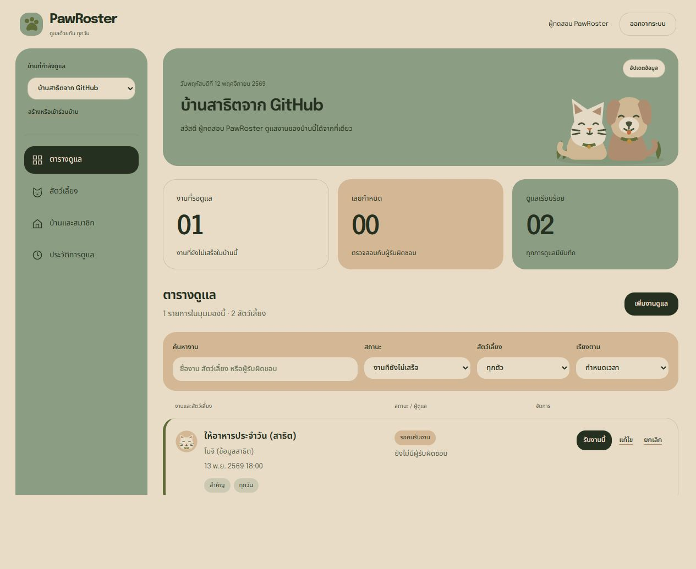

# ผลตรวจ PawRoster 2.0

วันที่ตรวจ: 12 พฤศจิกายน 2026

## ผลตรวจระบบ

- `npm run check`: ผ่านการตรวจไวยากรณ์ Backend และ Frontend
- [Windows tests](windows-tests.tap): ผ่าน 17 กรณี R1–R8 และ M1–M9 รวม 18 รายการเมื่อรวม Parent test
- [Linux tests](linux-tests.tap): ผ่านกรณีเดียวกันด้วย Node.js 24.14.0-alpine ใน Docker
- [Docker smoke และ Persistence](docker-smoke.txt): บันทึกผล HTTP flow หลายบ้าน งานซ้ำ การสำรองและตรวจ Integrity ของฐานข้อมูล การ Force-recreate แล้วตรวจ Membership/Session/งานเดิม และการถอนสิทธิ์สมาชิก
- Docker Build ใช้ `VCS_REF=worktree-v2` เนื่องจากเป็นการตรวจ Working tree ก่อนเผยแพร่ ไม่ใช่หลักฐานตรวจ Revision ของ Commit จาก SCM

## ผลตรวจส่วนติดต่อผู้ใช้

ข้อมูลทุกบัญชี บ้าน สัตว์เลี้ยง และงานในภาพเป็นข้อมูลสาธิตในเครื่อง

- บัญชีเดิมสร้างบ้านเพิ่มเติม ใช้คำเชิญของอีกบัญชี และสลับกลับบ้านเดิมได้
- งานซ้ำรายวันสร้างงานวันถัดไปหลังทำเสร็จได้หนึ่งรายการ
- แก้ไข ค้นหา และยกเลิกงานผ่านหน้าต่างยืนยันได้
- เพิ่มสัตว์เลี้ยงและข้อควรทราบ พร้อมภาพประกอบตามประเภท
- ตรวจ Desktop 1280 px และ Mobile 390 px ไม่พบ Horizontal overflow ในหน้าตารางงาน
- ฟอร์มบนมือถือเปิดและกรอกข้อมูลได้; Dialog มีข้อความผิดพลาดเฉพาะตำแหน่ง

[หน้าจอมือถือ](mobile.jpg) · [เข้าร่วมบ้านเพื่อนด้วยบัญชีเดิม](joined-home.jpg) · [ข้อมูลสัตว์เลี้ยง](pets.jpg)

## ขอบเขตของผลตรวจ

ผลข้างต้นมาจากเครื่อง Windows และ Linux container บน Docker Desktop ต่อมาตรวจรุ่น 2.0 จาก GitHub main ผ่าน SSH ในกล่องอาจารย์แล้ว ดู [หลักฐาน Course Container รุ่น 2.0](../course-v2-ssh/README.md) ส่วนผล Jenkins รุ่น 1.0 ไม่ใช้แทนการตรวจ Jenkins รุ่น 2.0

ยังไม่มีผลสัมภาษณ์หรือทดลองกับผู้เลี้ยงจริง ภาพสาธิตและ Automated tests ไม่ใช่หลักฐาน Social impact
